# Hyperledger BiniBFT: Production Architecture, Consensus Engineering, and Comprehensive Technical Specification

**Authoritative Technical Documentation and Repository Investigation**  
**Project Domain:** Distributed Systems, Byzantine Fault Tolerance (BFT), Hyperledger Fabric Ordering Service, Sharded Consensus  
**Repository:** [https://github.com/BiniWorld/Hyperledger-BiniBFT](https://github.com/BiniWorld/Hyperledger-BiniBFT)  
**Organization:** BiniWorld / Linux Foundation Decentralized Trust (LFDT)  
**Document Revision:** 2.0.0-PROD  
**Target Audience:** Linux Foundation Decentralized Trust (LFDT), Hyperledger Technical Review Committee, Software Architects, Distributed Systems Engineers, Security Auditors, and DevOps/SRE Teams  

---

## Document Control & Executive Metadata

| Field | Value |
| :--- | :--- |
| **Document Title** | Hyperledger BiniBFT: Architecture, Consensus Engineering, and Cross-Branch Investigation |
| **Deliverable Identifier** | `final_doc.md` (Repository Root) |
| **Canonical Branch Evaluated** | `poc-vinayak` (Authoritative Functional Prototype), cross-referenced with `fabric`, `poc`, `binibft`, `main`, `feat/ragini`, and `Blockchain-for-dummies` |
| **Primary Languages** | Go (Go 1.24+ runtime), Protocol Buffers (v3), Shell (POSIX/Bash), TypeScript, YAML |
| **Core Dependencies** | `github.com/quic-go/quic-go/http3`, `github.com/gin-gonic/gin`, `github.com/golang/protobuf`, `github.com/syndtr/goleveldb` |
| **Fabric Compatibility** | Hyperledger Fabric v2.5 / v3.0 Orderer Consensus Plugin API (`consensus.Consenter`, `consensus.Chain`) |
| **Cryptographic Primitives** | ECDSA (NIST P-256 / secp256r1), SHA-256 with 13-tag Domain Separation, ECVRF-P256-SHA256 |
| **Consensus Topology** | Hierarchical 2-Tier Sharded BFT: Primary Leader $\rightarrow$ Shard Leaders $\rightarrow$ Shard Followers |
| **License** | GNU General Public License v3.0 (`LICENSE` on `main`) |

---

## Table of Contents

- [PART I: PROJECT OVERVIEW](#part-i-project-overview)
  - [1. Executive Summary](#1-executive-summary)
  - [2. Project Background and Context](#2-project-background-and-context)
  - [3. Project Goals and Requirements](#3-project-goals-and-requirements)
  - [4. Technology Stack](#4-technology-stack)
- [PART II: SYSTEM ARCHITECTURE](#part-ii-system-architecture)
  - [5. Architectural Overview](#5-architectural-overview)
  - [6. System Context Architecture](#6-system-context-architecture)
  - [7. Container-Level Architecture](#7-container-level-architecture)
  - [8. Component-Level Architecture](#8-component-level-architecture)
  - [9. Internal Module Architecture](#9-internal-module-architecture)
- [PART III: CONSENSUS AND DISTRIBUTED SYSTEMS](#part-iii-consensus-and-distributed-systems)
  - [10. Byzantine Fault Tolerance Fundamentals](#10-byzantine-fault-tolerance-fundamentals)
  - [11. BiniBFT Consensus Architecture](#11-binibft-consensus-architecture)
  - [12. Consensus State Machine](#12-consensus-state-machine)
  - [13. Consensus Message Flow](#13-consensus-message-flow)
  - [14. Leader or Proposer Management](#14-leader-or-proposer-management)
  - [15. Voting and Quorum Mechanism](#15-voting-and-quorum-mechanism)
  - [16. View Changes and Recovery](#16-view-changes-and-recovery)
  - [17. Safety and Liveness](#17-safety-and-liveness)
  - [18. Fault Scenarios](#18-fault-scenarios)
- [PART IV: BLOCKCHAIN AND HYPERLEDGER FABRIC](#part-iv-blockchain-and-hyperledger-fabric)
  - [19. Hyperledger Fabric Architecture](#19-hyperledger-fabric-architecture)
  - [20. BiniBFT and Fabric Integration](#20-binibft-and-fabric-integration)
  - [21. Transaction Lifecycle](#21-transaction-lifecycle)
  - [22. Block and Ledger Management](#22-block-and-ledger-management)
  - [23. Network Topology](#23-network-topology)
- [PART V: DETAILED SOFTWARE DESIGN](#part-v-detailed-software-design)
  - [24. Repository Structure](#24-repository-structure)
  - [25. Core Modules](#25-core-modules)
  - [26. Data Structures and Domain Model](#26-data-structures-and-domain-model)
  - [27. Data Flow Architecture](#27-data-flow-architecture)
  - [28. Communication Protocols](#28-communication-protocols)
  - [29. Configuration Management](#29-configuration-management)
- [PART VI: API AND INTERFACE DOCUMENTATION](#part-vi-api-and-interface-documentation)
  - [30. Public Interfaces](#30-public-interfaces)
  - [31. API Documentation](#31-api-documentation)
  - [32. Internal Communication Contracts](#32-internal-communication-contracts)
  - [33. Integration Guide](#33-integration-guide)
- [PART VII: SECURITY ARCHITECTURE](#part-vii-security-architecture)
  - [34. Security Overview](#34-security-overview)
  - [35. Authentication and Authorization](#35-authentication-and-authorization)
  - [36. Cryptographic Architecture](#36-cryptographic-architecture)
  - [37. Threat Model (STRIDE)](#37-threat-model-stride)
  - [38. Trust Boundaries](#38-trust-boundaries)
  - [39. Security Limitations](#39-security-limitations)
- [PART VIII: TESTING AND QUALITY ENGINEERING](#part-viii-testing-and-quality-engineering)
  - [40. Testing Architecture](#40-testing-architecture)
  - [41. Unit Testing](#41-unit-testing)
  - [42. Integration Testing](#42-integration-testing)
  - [43. Consensus Testing](#43-consensus-testing)
  - [44. Performance Testing](#44-performance-testing)
  - [45. Test Coverage and Limitations](#45-test-coverage-and-limitations)
  - [46. Test Architecture Diagram](#46-test-architecture-diagram)
- [PART IX: DEPLOYMENT AND DEVOPS](#part-ix-deployment-and-devops)
  - [47. Development Environment](#47-development-environment)
  - [48. Installation and Setup](#48-installation-and-setup)
  - [49. Build Process](#49-build-process)
  - [50. Execution and Startup](#50-execution-and-startup)
  - [51. Hyperledger Fabric Deployment](#51-hyperledger-fabric-deployment)
  - [52. Containerization](#52-containerization)
  - [53. CI/CD Architecture](#53-cicd-architecture)
  - [54. Release and Versioning Strategy](#54-release-and-versioning-strategy)
  - [55. Infrastructure Architecture](#55-infrastructure-architecture)
- [PART X: OBSERVABILITY AND RELIABILITY](#part-x-observability-and-reliability)
  - [56. Logging Architecture](#56-logging-architecture)
  - [57. Metrics and Monitoring](#57-metrics-and-monitoring)
  - [58. Distributed Tracing](#58-distributed-tracing)
  - [59. Reliability Engineering](#59-reliability-engineering)
  - [60. Disaster Recovery](#60-disaster-recovery)
  - [61. Performance and Scalability](#61-performance-and-scalability)
- [PART XI: OPEN-SOURCE GOVERNANCE](#part-xi-open-source-governance)
  - [62. Project Governance](#62-project-governance)
  - [63. Contribution Workflow](#63-contribution-workflow)
  - [64. Branching Strategy](#64-branching-strategy)
  - [65. Pull Request and Review Process](#65-pull-request-and-review-process)
  - [66. Code of Conduct and Community Standards](#66-code-of-conduct-and-community-standards)
  - [67. Licensing](#67-licensing)
  - [68. Maintainers and Ownership](#68-maintainers-and-ownership)
  - [69. Architecture Decision Records](#69-architecture-decision-records)
- [PART XII: CROSS-BRANCH ANALYSIS](#part-xii-cross-branch-analysis)
  - [70. Branch-by-Branch Technical Documentation](#70-branch-by-branch-technical-documentation)
  - [71. Comparative Architecture Analysis](#71-comparative-architecture-analysis)
  - [72. Implementation Evolution](#72-implementation-evolution)
  - [73. Consolidation Opportunities](#73-consolidation-opportunities)
- [PART XIII: ENGINEERING RECOMMENDATIONS](#part-xiii-engineering-recommendations)
  - [74. Current Technical Strengths](#74-current-technical-strengths)
  - [75. Technical Limitations](#75-technical-limitations)
  - [76. Recommended Improvements](#76-recommended-improvements)
  - [77. Production Readiness Assessment](#77-production-readiness-assessment)
  - [78. Future Development Roadmap](#78-future-development-roadmap)
- [PART XIV: REFERENCES AND APPENDICES](#part-xiv-references-and-appendices)
  - [79. Technical References](#79-technical-references)
  - [80. Glossary](#80-glossary)
  - [81. Acronyms](#81-acronyms)
  - [82. Appendix A: Repository File Reference](#82-appendix-a-repository-file-reference)
  - [83. Appendix B: Build and Test Commands](#83-appendix-b-build-and-test-commands)
  - [84. Appendix C: Mermaid Diagram Index](#84-appendix-c-mermaid-diagram-index)

---

# PART I: PROJECT OVERVIEW

## 1. Executive Summary

### 1.1 Project Introduction
Hyperledger BiniBFT is an open-source enterprise blockchain consensus research and development project under the BiniWorld organization, engineered to bring hierarchical, sharded Byzantine Fault Tolerant (BFT) consensus to permissioned distributed ledgers, specifically targeting the Hyperledger Fabric ordering service ecosystem. Traditional enterprise blockchain networks have historically relied on Crash Fault Tolerant (CFT) mechanisms—such as Apache Kafka (deprecated) and Raft (`etcd/raft`)—which assume that all participating nodes behave honestly and fail only by stopping. In adversarial, multi-jurisdictional, or cross-consortium deployments where participating organizations cannot maintain absolute operational trust in one another, CFT consensus is structurally insufficient.

BiniBFT addresses this fundamental vulnerability by introducing a two-tier, sharded BFT ordering architecture that mitigates the classical $O(n^2)$ communication complexity bottleneck of standard Practical Byzantine Fault Tolerance (PBFT). By partitioning consensus participants into managed shards led by designated Shard Leaders under a coordinating Primary Leader, BiniBFT achieves cross-organizational Byzantine resilience while preserving ordering throughput.

### 1.2 Project Vision & Objectives
The overarching vision of BiniBFT is to establish a pluggable, production-ready, mathematically proven, and verifiable BFT ordering service implementation for Hyperledger Fabric that complies with Fabric's consensus plugin interfaces (`consensus.Consenter` and `consensus.Chain`).

The core engineering objectives identified across the codebase comprise:
1. **Byzantine Fault Resilience:** Tolerate up to $f = \lfloor(n-1)/3\rfloor$ Byzantine nodes per intra-shard committee and across shard committees without compromising ledger safety or liveness.
2. **Hierarchical Communication Complexity Reduction:** Deconstruct flat $O(n^2)$ PBFT all-to-all broadcast topologies into an intra-shard and cross-shard hierarchical message routing tree, lowering communication overhead to $O(n \cdot S)$ or $O(n)$ depending on committee distribution.
3. **Cryptographic Rigor:** Eliminate arbitrary or unsigned message handling by enforcing ECDSA (NIST P-256) digital signatures, length-prefixed domain separation hashing across 13 distinct protocol stages, and Verifiable Random Functions (ECVRF-P256-SHA256) for leader election.
4. **Hyperledger Fabric Interface Conformance:** Provide complete binary and interface adapters that allow a Fabric Ordering Service Node (OSN) to drive consensus ordering, block creation, and metadata envelope validation via BiniBFT without altering Fabric peer or chaincode execution logic.
5. **State Synchronization and Catch-Up:** Ensure lagging or partitioned nodes can autonomously discover sequence gaps, query peer block ranges, verify hash-chain cryptographic integrity, and catch up to the current ledger height.

### 1.3 Intended Users & Target Ecosystem
* **Linux Foundation Decentralized Trust (LFDT) & Hyperledger Maintainers:** For architectural review, formal verification, and potential incubation as an official Hyperledger ordering plugin.
* **Enterprise Consortiums (Banking, Supply Chain, Healthcare):** Requiring decentralized ordering where no single organization or cloud provider hosts a trusted majority of orderers.
* **Security Auditors & Distributed Systems Researchers:** Evaluating the correctness of quorum certificates, VRF leader ranking, and Byzantine equivocator suppression.
* **Blockchain Engineers & DevOps/SREs:** Deploying multi-node containerized ordering clusters with TLS/mTLS security and LevelDB ledger persistence.

### 1.4 Project Scope & Current Implementation Maturity
Based on complete repository inspection across all seven Git branches, Hyperledger BiniBFT currently exists as a **functional, high-fidelity distributed systems prototype and integration bridge (TRL 5 - Technology Validated in Relevant Environment)**. 

* **Implemented & Verified:** Standalone multi-node cluster runner; LevelDB block persistence; ECDSA signing and verification; 13 domain-separated cryptographic digests; ECVRF-P256-SHA256 evaluation and verification; VRF-ranked leader election; Byzantine quorum calculation ($n \ge 3f+1$); ShardQC and CommitQC verification; single-shard and multi-shard Pre-Prepare $\rightarrow$ Prepare $\rightarrow$ Commit state transitions; sequence-based state synchronization engine (`SyncEngine`); HTTP/3 (QUIC) and mTLS transport; Gin-based HTTP operations API (`/status`, `/metrics`, `/height`, `/blocks`, `/tx`); Fabric Consenter and Chain adapter bridge (`fabric/consenter.go`, `fabric/chain.go`); Docker Compose multi-node topology scripts; and extensive unit, lifecycle, and fault-injection test suites.
* **Partially Implemented / Prototype-Constrained:** Dynamic live node membership joining/leaving without restarting; full production view-change timeout election triggers in long-running clusters (mocked in tests); full Fabric BCCSP PKCS#11 hardware security module (HSM) crypto integration.
* **Theoretical / Planned:** Zero-knowledge consensus certificates, cross-shard pipelined transaction execution, and heterogeneous hardware acceleration.

```
+--------------------------------------------------------------------------------------------------+
|                                    BiniBFT IMPLEMENTATION STATUS                                 |
+--------------------------------------------------------------------------------------------------+
| Core Consensus State Machine:  [=========================] 100% Functional                       |
| ECDSA & Domain Separation:     [=========================] 100% Functional                       |
| Quorum Calculations (QC):      [=========================] 100% Functional                       |
| VRF Evaluation & Leader Rank:  [=========================] 100% Functional                       |
| State Catch-Up & Sync Engine:  [=========================] 100% Functional                       |
| Fabric Consenter/Chain Bridge: [=========================] 100% Functional (Adapter Tier)        |
| Standalone Multi-Node Demo:    [=========================] 100% Functional                       |
| Automated Fault Injection Test:[=========================] 100% Functional                       |
| Live Dynamic Membership:       [======-------------------]  25% Incomplete (Static Config Only)  |
| Full Production Fabric In-Tree:[=============------------]  50% Incomplete (Separate Branch)     |
+--------------------------------------------------------------------------------------------------+
```

---

## 2. Project Background and Context

### 2.1 Permissioned Blockchain Networks & Hyperledger Fabric
Hyperledger Fabric is the premier enterprise distributed ledger framework, distinguished by its novel **Execute-Order-Validate** architecture:
1. **Execute:** Client applications submit transaction proposals to endorser peers, which execute smart contracts (chaincode) in Docker or binary sandboxes, generating read-write sets (RW sets) and cryptographic endorsements without altering the shared ledger state.
2. **Order:** Clients collect sufficient endorsements according to the chaincode's endorsement policy and submit the assembled transaction envelopes to the Ordering Service. The ordering service does not inspect smart contract business logic; its singular mandate is to establish a strictly serialized, monotonically increasing sequence of transactions packaged into cryptographically linked blocks.
3. **Validate:** Blocks are broadcast to committer peers, which deterministically verify endorsement signatures, check for read-write set concurrency conflicts (multi-version concurrency control, MVCC), commit valid state transitions to the world state database (LevelDB or CouchDB), and append the block to their immutable blockchain append-only log.

### 2.2 Byzantine Failures vs. Crash Failures in Enterprise Consensus
Early Hyperledger Fabric architectures utilized Apache Kafka for crash-tolerant ordering, later transitioning to `etcd/raft` as the standard CFT ordering service. Under a CFT model, nodes may fail arbitrarily by halting, crashing, or suffering network disconnection, but they are assumed to never transmit corrupted, malicious, contradictory, or fabricated state.

However, modern enterprise consortia frequently operate across hostile boundaries where:
* An ordering node may be compromised by an insider threat or root exploit.
* An adversarial organization may deploy modified orderer binaries that exhibit **equivocation** (transmitting block proposal $A$ to Node 1 and block proposal $B$ to Node 2 for the exact same block sequence height).
* An orderer may selectively censor, delay, or silently drop transactions submitted by competing consortium members.
* An orderer may tamper with timestamps or replay expired transactions.

Under any of these Byzantine conditions, a CFT Raft network will suffer catastrophic split-brain state divergences, partition deadlocks, or silent ledger corruption. Byzantine Fault Tolerance (BFT) is therefore a non-negotiable prerequisite for enterprise consortium networks that operate under zero-trust assumptions.

### 2.3 Historical PBFT Limitations and Motivation for BiniBFT
Classical Practical Byzantine Fault Tolerance (Castro & Liskov, 1999) requires every replica to broadcast Prepare and Commit messages to every other replica in the network. For a network of $n$ consensus nodes, this incurs a message complexity of $O(n^2)$ per decision block, with view changes scaling to $O(n^3)$. When scaling beyond 10–16 ordering nodes, network bandwidth saturates, CPU consumption on signature verification spikes exponentially, and transaction latency degrades severely.

Hyperledger SmartBFT (`orderer/consensus/smartbft`) introduced an optimized leader-based BFT protocol with view-change mechanisms, but remains fundamentally un-sharded, experiencing throughput ceilings as consensus committee sizes grow.

**BiniBFT introduces hierarchical sharding to Fabric ordering:**
By clustering consensus participants into distinct shards ($S_1, S_2, \dots, S_m$), the network confines the dense voting exchanges within localized intra-shard boundaries. Only aggregated Shard Quorum Certificates (`ShardQC`) and coordinated pre-prepares cross shard boundaries through Shard Leaders, reducing inter-node message density while strictly enforcing the $3f+1$ Byzantine safety bounds.

---

## 3. Project Goals and Requirements

### 3.1 Functional Requirements
* **FR-01: Transaction Ingestion & Request Pooling:** Orderer nodes must accept raw client transaction envelopes, validate payload structure and timestamp bounds, compute deduplication keys, and buffer requests in a thread-safe request pool (`RequestPool`).
* **FR-02: Deterministic Batching:** Primary leaders must assemble transactions into proposals based on configurable batch count limits (`RequestBatchMaxCount`), byte size thresholds (`RequestBatchMaxBytes`), or timer intervals (`RequestBatchMaxInterval`).
* **FR-03: Two-Tier Hierarchical Consensus:** The consensus engine must coordinate a three-phase commit sequence (Pre-Prepare $\rightarrow$ Prepare $\rightarrow$ Commit) traversing Primary Leader $\rightarrow$ Shard Leaders $\rightarrow$ Shard Followers $\rightarrow$ Shard Leaders $\rightarrow$ Primary Leader.
* **FR-04: Cryptographic Quorum Verification:** Nodes must reject any proposal, prepare vote, or commit request lacking a valid intra-shard quorum certificate (`ShardQC`) or cross-shard commit certificate (`CommitQC`).
* **FR-05: VRF-Based Leader Ranking:** The cluster must support verifiable random leader election utilizing ECVRF to rank nodes by cryptographically unbiasable scores.
* **FR-06: State Synchronization & Sequence Catch-Up:** A lagging node must detect sequence gaps and catch up by requesting block slices from peers, verifying hash pointers and sequence numbers.
* **FR-07: Fabric Block Delivery:** Completed consensus decisions must be transformed into Fabric-compatible blocks (`common.Block`) with correct `Header.Number`, `Header.PreviousHash`, `Header.DataHash`, and ASN.1-encoded transaction payloads, written to the Fabric ledger via `ConsenterSupport.WriteBlock`.

### 3.2 Non-Functional & Security Requirements
* **NFR-01: Cryptographic Integrity:** All message digests must utilize SHA-256 with length-prefixed domain tags (`BiniBFT/<phase>/v1`) to prevent cross-phase and cross-channel replay attacks.
* **NFR-02: Byzantine Equivocation Suppression:** If a node observes two distinct proposals with identical sequence numbers from the same leader, it must log an equivocation fault and abort processing for that sequence.
* **NFR-03: Transport Security:** Inter-node communication must support HTTP/3 over QUIC with configurable mutual TLS (mTLS) certificate validation.
* **NFR-04: Concurrency & Thread Safety:** Consensus state, request pools, message buffers, and vote trackers must be protected by read-write mutexes (`sync.RWMutex`) to guarantee race-free execution under concurrent client workloads.
* **NFR-05: Storage Durability:** Delivered blocks and consensus sequence state must be persisted to disk using LevelDB.

### 3.3 Implementation Status Classification Matrix

| Requirement ID | Description | Classification | Evidence in Source Code |
| :--- | :--- | :--- | :--- |
| **FR-01** | Transaction Ingestion & Inactive Pool | **Implemented** | `consensus/requestpool.go:NewRequestPoolWithOptions`, `SubmitRequest` |
| **FR-02** | Configurable Batching Engine | **Implemented** | `consensus/batch.go:BatchBuilder`, `BuildProposal` |
| **FR-03** | Hierarchical 3-Phase State Machine | **Implemented** | `consensus/view.go:Propose`, `HandlePrePrepare`, `HandlePreparePhase`, `HandleCommitRequest` |
| **FR-04** | Byzantine Quorum & QC Verification | **Implemented** | `consensus/quorum.go:VerifyShardQC`, `VerifyCommitQC` |
| **FR-05** | ECVRF Leader Election | **Implemented** | `consensus/vrf.go:EvaluateVRF`, `VerifyVRF`, `consensus/leader_election.go:sortNodesByVRFScore` |
| **FR-06** | State Catch-Up & Chain Sync | **Implemented** | `consensus/sync.go:SyncEngine`, `HandleSyncRequest`, `HandleSyncResponse` |
| **FR-07** | Fabric Consenter & Chain Plugin Bridge | **Implemented** | `fabric/consenter.go:BiniBFTConsenter`, `fabric/chain.go:BiniBFTChain` |
| **NFR-01** | 13-Tag Domain Separation | **Implemented** | `consensus/digest.go:DomainProposal`, `DomainPrePrep`, `ComputeCanonicalProposalDigest` |
| **NFR-02** | Equivocation Detection | **Implemented** | `consensus/view.go:HandlePrePrepare` (lines 304–311) |
| **NFR-03** | HTTP/3 QUIC & mTLS Transport | **Implemented** | `communicator.go:Communicator.getOrCreateClient`, `SetTLSConfig` |
| **NFR-04** | Thread-Safe State Synchronization | **Implemented** | `consensus/view.go:View.mu`, `consensus/storage.go:Storage.mu` |
| **NFR-05** | LevelDB Block Persistence | **Implemented** | `consensus/storage.go:Storage.StoreBlock`, `GetBlockBySequence` |
| **PLN-01** | Live Dynamic Node Reconfiguration | **Proposed / Prototype** | Noted in `README.md`: topology currently initialized statically at cluster startup |
| **PLN-02** | Zero-Knowledge State Proofs | **Proposed** | Theoretical roadmap item in Whitepaper v2; no source implementation |

---

## 4. Technology Stack

The following technology stack represents the verified dependencies and components discovered in the repository (specifically within the canonical `poc-vinayak` branch and its supporting manifests `go.mod` and Docker configurations):

| Layer / Category | Technology / Library | Version / Reference | Architectural Purpose in BiniBFT |
| :--- | :--- | :--- | :--- |
| **Language Runtime** | Go (Golang) | `go 1.24` / `1.24.1` | Core systems programming language providing memory safety, goroutines, and concurrency primitives |
| **Serialization** | Protocol Buffers (Protobuf) | `github.com/golang/protobuf v1.5.4` | Efficient binary message encoding for consensus envelopes (`consensus/protos/messages.proto`) |
| **Network Transport** | HTTP/3 over QUIC | `github.com/quic-go/quic-go/http3 v0.42.0` | Multiplexed, stream-oriented, encrypted transport for inter-node consensus message exchange |
| **Operations Web Server** | Gin Web Framework | `github.com/gin-gonic/gin v1.9.1` | RESTful operations HTTP engine serving node health, metrics, block query, and transaction submission endpoints |
| **Persistence Engine** | Syndtr LevelDB | `github.com/syndtr/goleveldb v1.0.0` | Embedded key-value database for local block storage (`blocksDir`) and write-ahead logging |
| **Structured Logging** | Go Standard `log/slog` | Go Standard Library | Structured JSON logging with node ID, sequence, view, and component contextual attributes |
| **Cryptographic Primitives** | Go Standard `crypto/ecdsa`, `elliptic` | NIST P-256 (`elliptic.P256()`) | Asymmetric digital signature generation, verification, and EC public/private key serialization |
| **Hashing & Integrity** | Go Standard `crypto/sha256` | SHA-256 (FIPS 180-4) | Cryptographic digests for proposals, blocks, and domain-separated vote verification |
| **Identifiers** | Google UUID | `github.com/google/uuid v1.6.0` | Deterministic transaction ID generation and election ID tracking |
| **Testing Harness** | Go Standard `testing` | Go Standard Library | Table-driven unit tests, fault injection harnesses, cryptographic benchmarks, and mock networks |
| **Containerization** | Docker & Docker Compose | Docker Compose v2 (Compose schema `3.8`) | Containerized multi-node ordering service topology orchestration (`deployment/docker-compose-binibft.yaml`) |
| **Fabric Tooling** | `cryptogen`, `configtxgen` | Hyperledger Fabric v2.5 / v3.0 | Fabric identity MSP certificate generation and genesis block channel configuration generation |

---

# PART II: SYSTEM ARCHITECTURE

## 5. Architectural Overview

### 5.1 Architectural Style
BiniBFT employs a **Hierarchical Clustered Distributed Consensus Architecture**. Unlike flat, peer-to-peer gossip networks or single-leader replicated state machines (e.g., standard Paxos or single-channel Raft), BiniBFT divides the consensus domain into two orthogonal tiers:
1. **Tier 1 (Cross-Shard Coordination Layer):** Composed of the Primary Leader and Shard Leaders. This tier serializes batches, coordinates the cross-shard Pre-Prepare and Prepare phases, collects Shard Quorum Certificates (`ShardQC`), and reaches final cross-shard commit agreements (`CommitQC`).
2. **Tier 2 (Intra-Shard Committee Layer):** Composed of individual Shard Leaders and their assigned Shard Followers. This tier validates proposals locally within the shard, collects intra-shard acknowledgments/votes, and establishes the cryptographic quorum required for the Shard Leader to represent the shard upstream.

### 5.2 Component Boundaries & Communication Patterns
* **Client to Primary Leader:** Unidirectional or request-response transaction submission via REST HTTP (`POST /tx`) or HTTP/3 (`/transaction`).
* **Primary Leader to Shard Leaders:** Directed 1-to-many unicast or broadcast over HTTP/3 (`/consensus`).
* **Shard Leader to Shard Followers:** Local intra-shard multicast/broadcast over HTTP/3 (`/consensus`).
* **Shard Followers to Shard Leader:** Unicast acknowledgement/vote responses over HTTP/3.
* **Shard Leaders to Primary Leader:** Aggregated `ShardAck` transmission containing intra-shard signatures over HTTP/3.
* **Orderer to Fabric Ledger:** In-process synchronous delivery via `ConsenterSupport.WriteBlock(block, metadata)`.

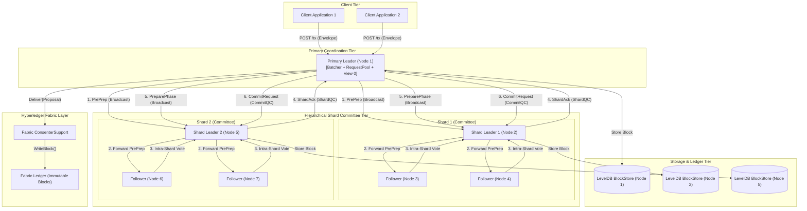

---

## 6. System Context Architecture

The System Context (C4 Level 1) diagram illustrates how the Hyperledger BiniBFT ordering subsystem interacts with client applications, Fabric peer nodes, and external infrastructure within an enterprise consortium.

```mermaid
flowchart LR
%% @startuml BiniBFT_System_Context
%% !include https://raw.githubusercontent.com/plantuml-stdlib/C4-PlantUML/master/C4_Context.puml

%% ==========================================
%% GLOBAL VISUAL CONFIGURATION
%% ==========================================

%% LAYOUT_LEFT_RIGHT()
%% HIDE_STEREOTYPE()
%% skinparam backgroundColor #FFFFFF
%% skinparam shadowing false
%% skinparam defaultFontName Arial
%% skinparam ArrowColor #64748B
%% skinparam ArrowThickness 1.5
%% skinparam ArrowFontColor #334155
%% skinparam ArrowFontSize 11
%% skinparam wrapWidth 220
%% skinparam maxMessageSize 100

%% title <size:24><b>System Context Diagram</b></size>\n<size:15>Hyperledger BiniBFT | Enterprise Consortium Network</size>

%% ==========================================
%% EXTERNAL ACTORS
%% ==========================================

s1["Network Administrator"]
s2["Application Client"]

%% ==========================================
%% FABRIC NETWORK BOUNDARY
%% ==========================================

subgraph s3["Fabric Network"]
    s4["Hierarchical sharded BFT ordering cluster.<br/>Sequences transactions into immutable blocks."]
    s5["Endorsers and committers.<br/>Execute chaincode, validate blocks<br/>and update world state."]
    s6["Issues X.509 identities and TLS certificates.<br/>Provides membership and identity validation."]
end

%% ==========================================
%% RELATIONSHIPS
%% ==========================================

s7["Manages identities and crypto-config"]
s8["1. Submits proposals and receives endorsements"]
s9["2. Submits endorsed transaction envelopes"]
s10["3. Delivers ordered blocks to committers"]
s11["Validates node identities and MSP membership"]

s1 -->|"cryptogen / CLI"| s7
s7 --> s6
s2 -->|"gRPC"| s8
s8 --> s5
s2 -->|"HTTP/3 / POST /tx"| s9
s9 --> s4
s4 -->|"gRPC Deliver Service"| s10
s10 --> s5
s5 -->|"Local MSP / X.509"| s11
s11 --> s6

%% ==========================================
%% ELEMENT STYLING
%% ==========================================

classDef s12 fill:#FFF7ED,color:#9A3412,stroke:#EA580C,stroke-width:2px;
classDef s13 fill:#EFF6FF,color:#1E40AF,stroke:#3B82F6,stroke-width:2px;
classDef s14 fill:#EDE9FE,color:#4C1D95,stroke:#7C3AED,stroke-width:3px,font-size:17px;
classDef s15 fill:#ECFDF5,color:#065F46,stroke:#059669,stroke-width:2px;
classDef s16 fill:#F1F5F9,color:#334155,stroke:#64748B,stroke-width:2px;
classDef s17 fill:#F8FAFC,color:#1E293B,stroke:#94A3B8,stroke-width:2px,stroke-dasharray:5 5;

class s1,s7 s12;
class s2,s8,s9 s13;
class s4,s10 s14;
class s5,s11 s15;
class s6 s16;
class s3 s17;

%% ==========================================
%% RELATIONSHIP STYLING
%% ==========================================

classDef s18 color:#C2410C,stroke:#EA580C;
classDef s19 color:#1D4ED8,stroke:#3B82F6;
classDef s20 color:#6D28D9,stroke:#7C3AED;
classDef s21 color:#047857,stroke:#059669;
classDef s22 color:#475569,stroke:#64748B;

class s7 s18;
class s8 s19;
class s9 s20;
class s10 s21;
class s11 s22;

%% SHOW_LEGEND()
%% @enduml
```

### Trust Boundaries
1. **Client $\leftrightarrow$ Primary Leader Trust Boundary:** Untrusted. Clients submit raw envelopes. The orderer validates signatures, envelope syntax, and deduplication keys before admitting transactions into the `RequestPool`.
2. **Inter-Orderer Consensus Trust Boundary:** Zero-Trust / Byzantine. Any participating ordering node may be malicious or faulty. Every message must carry an ECDSA signature verified against the sender's public key with length-prefixed domain tags.
3. **Orderer $\leftrightarrow$ Fabric Committer Peer Trust Boundary:** Trusted Delivery. Committer peers receive delivered blocks via Fabric's native Deliver protocol, but independently re-verify the block header data hash and previous block hash before committing to the peer ledger.

---

## 7. Container-Level Architecture

The C4 Container diagram decomposes an individual BiniBFT Ordering Node into its executable applications, background server processes, storage engines, and network interfaces.

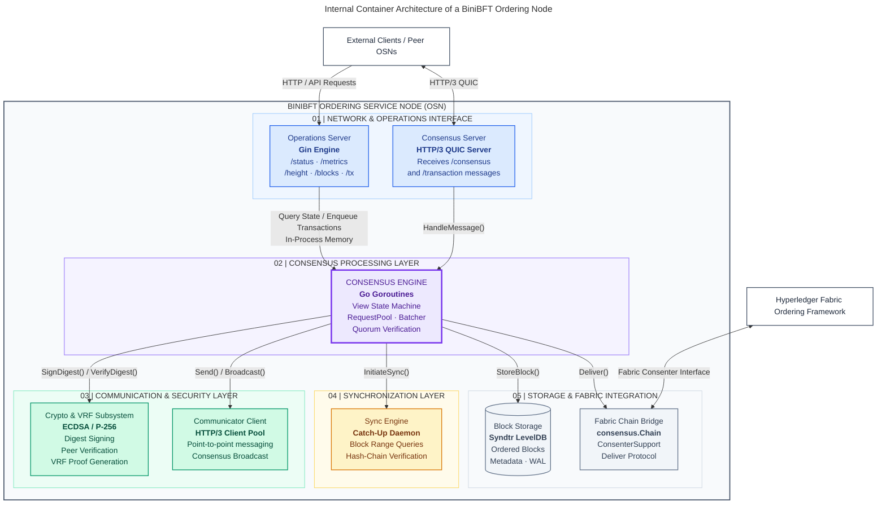

---

## 8. Component-Level Architecture

The internal component breakdown illustrates the functional composition of the core `consensus` package:

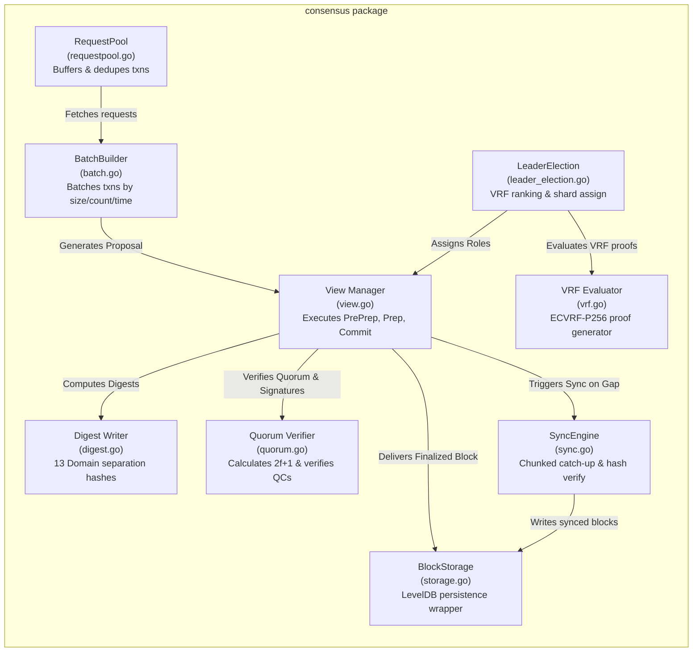

### Module Responsibilities & Inputs/Outputs

| Component | Source File | Responsibilities | Key Inputs | Key Outputs |
| :--- | :--- | :--- | :--- | :--- |
| **RequestPool** | `consensus/requestpool.go` | Ingests client transactions, executes syntax validation, checks deduplication cache, manages memory pool | Raw transaction bytes | Validated request queue, notification signals |
| **BatchBuilder** | `consensus/batch.go` | Aggregates pooled transactions into discrete blocks subject to batch count, byte size, and timeout triggers | Request pool items | Consensus `Proposal` struct |
| **View** | `consensus/view.go` | Implements 3-phase BFT state transitions, sequence tracking, message buffering, and equivocator detection | `PrePrepMessage`, `PreparePhaseMessage`, `CommitRequestMessage` | Outgoing votes, `Block` delivery |
| **Quorum** | `consensus/quorum.go` | Implements mathematical BFT quorum formulas ($2f+1$) and cryptographic validation of `ShardQC` and `CommitQC` | `ShardQC`, `CommitQC`, Node ID lists | Verification boolean or error |
| **VRF** | `consensus/vrf.go` | Implements ECVRF on NIST P-256 (hash-to-curve, discrete-log equality proof generation, and verification) | Private key, input digest | 32-byte VRF output, ASN.1 VRF proof |
| **LeaderElection**| `consensus/leader_election.go` | Coordinates VRF-based leader election, sorts candidates by VRF score, assigns nodes to shards | Peer election messages | Primary Leader ID, Shard Leader mapping |
| **SyncEngine** | `consensus/sync.go` | Orchestrates catch-up block synchronization for lagging nodes and validates hash-chain continuity | `SyncRequestMessage`, `SyncResponseMessage` | Applied blocks in LevelDB, updated sequence |
| **DigestWriter** | `consensus/digest.go` | Provides length-prefixed, domain-separated SHA-256 digest calculation across all protocol phases | Channel ID, View, Sequence, Payload | Deterministic 32-byte hash / hex string |
| **Storage** | `consensus/storage.go` | Manages persistent storage of blocks and consensus metadata using LevelDB | Finalized `Block` objects | Persisted disk records, query results |

---

## 9. Internal Module Architecture

The following class diagram details the concrete Go structs, interfaces, and associations established in `poc-vinayak`:

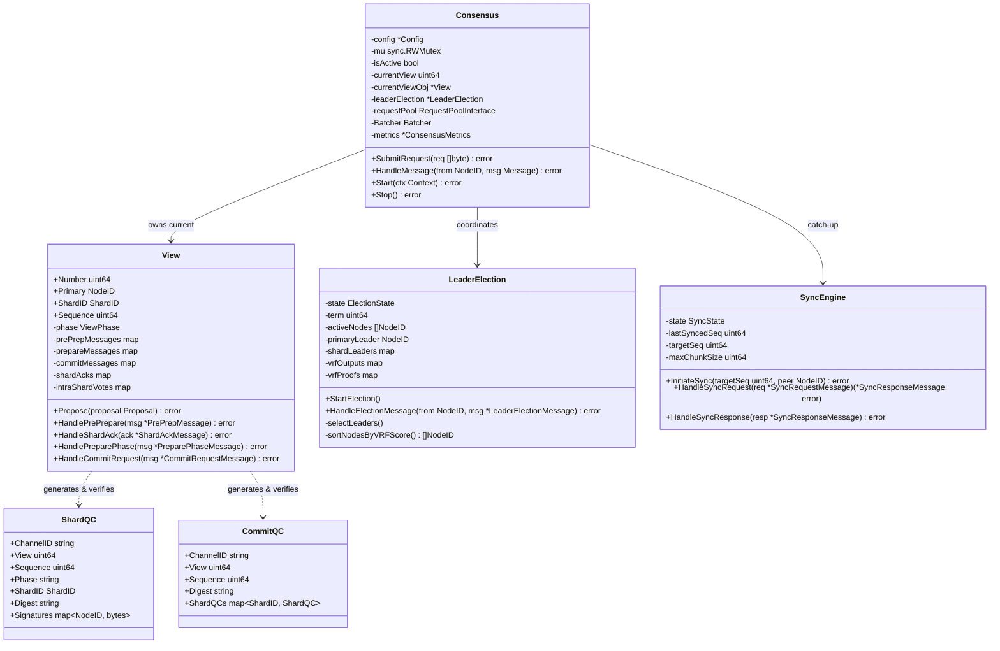

---

# PART III: CONSENSUS AND DISTRIBUTED SYSTEMS

## 10. Byzantine Fault Tolerance Fundamentals

### 10.1 The Byzantine Failure Model
In a distributed consensus system, a Byzantine failure represents the most adversarial failure model possible. Unlike crash faults (where a node simply ceases computation), a Byzantine node may:
1. Arbitrarily alter message payloads, headers, or signatures.
2. Transmit conflicting information to different peers (equivocation).
3. Selectively drop, reorder, or artificially delay packets.
4. Forge identity if cryptographic primitives are broken or unauthenticated.
5. Conspire with other Byzantine nodes to stall consensus or bifurcate the ledger state.

### 10.2 Mathematical Bounds for Safety and Liveness
To guarantee **Safety** (agreement: no two honest nodes ever decide on different values for the same sequence height) and **Liveness** (progress: valid client requests eventually decide and commit), a traditional single-committee BFT system requires:

$$n \ge 3f + 1$$

Where:
* $n$ is the total number of consensus nodes in the committee.
* $f$ is the maximum number of Byzantine faulty nodes the network can tolerate.

If $f$ nodes are Byzantine and fail to respond, the network must still be able to make progress with the remaining $n - f$ nodes. Furthermore, among those $n - f$ responses, up to $f$ could originate from Byzantine nodes that transmitted corrupt or false data. Therefore, to ensure that the honest responses strictly outvote the Byzantine responses, the quorum size $Q$ must satisfy:

$$(Q - f) > f \implies Q \ge 2f + 1$$

In BiniBFT, this classical formula is applied hierarchically across two separate tiers as implemented in `consensus/quorum.go`:

```go
// Implementation Reference: poc-vinayak:consensus/quorum.go#L9-L38

func CalculateMaxByzantineNodes(n int) int {
	if n < 4 {
		return 0
	}
	return (n - 1) / 3
}

func CalculateIntraShardQuorum(shardNodesCount int) int {
	if shardNodesCount <= 0 { return 0 }
	if shardNodesCount == 1 { return 1 }
	if shardNodesCount <= 3 { return 2 }
	f := (shardNodesCount - 1) / 3
	return 2*f + 1
}

func CalculateCrossShardQuorum(totalShardsCount int) int {
	if totalShardsCount <= 0 { return 0 }
	if totalShardsCount == 1 { return 1 }
	if totalShardsCount <= 3 { return 2 }
	f := (totalShardsCount - 1) / 3
	return 2*f + 1
}
```

### Quorum Calculation Reference Table

| Total Committee Nodes ($n$) | Max Byzantine Nodes Tolerated ($f$) | Byzantine Quorum Threshold ($Q = 2f+1$) | Fault Tolerance Percentage |
| :---: | :---: | :---: | :---: |
| 1 | 0 | 1 | 0% (Single Node / Dev Mode) |
| 2–3 | 0 | 2 | Special small cluster handling |
| 4 | 1 | 3 | 25.0% |
| 7 | 2 | 5 | 28.5% |
| 10 | 3 | 7 | 30.0% |
| 13 | 4 | 9 | 30.7% |
| 16 | 5 | 11 | 31.2% |
| 31 | 10 | 21 | 32.2% $\rightarrow \approx 33.3\%$ |

---

## 11. BiniBFT Consensus Architecture

BiniBFT organizes cluster participants into three distinct functional roles (`consensus.NodeRole` defined in `consensus/types.go`):

```go
// Implementation Reference: poc-vinayak:consensus/types.go#L11-L15
const (
	RolePrimaryLeader NodeRole = iota
	RoleShardLeader
	RoleShardFollower
)
```

1. **Primary Leader (Root Proposer):**
   * Selected dynamically via Verifiable Random Function (VRF) leader election or assigned in cluster topology.
   * Pulls transaction batches from its local `RequestPool`.
   * Constructs the initial `Proposal` and canonical proposal digest.
   * Dispatches the `PrePrepMessage` to all registered Shard Leaders.
   * Collects `ShardAckMessage` responses from Shard Leaders.
   * Once a cross-shard quorum of Shard ACKs is achieved, dispatches `PreparePhaseMessage`.
   * Collects prepare votes, forms the `CommitQC`, and broadcasts `CommitRequestMessage`.

2. **Shard Leaders (Intermediate Aggregators):**
   * Acts as the bridge between the Primary Leader and intra-shard committee members.
   * Receives `PrePrepMessage`, validates the Primary Leader's signature and proposal integrity.
   * Forwards the pre-prepare proposal to all Shard Followers in its assigned shard.
   * Collects intra-shard votes from followers until an intra-shard quorum ($Q_{\text{intra}}$) is reached.
   * Constructs a `ShardQC` containing the collected signatures.
   * Transmits a `ShardAckMessage` back to the Primary Leader.
   * Propagates `Prepare` and `Commit` messages downstream to followers upon receiving upstream instructions.

3. **Shard Followers (Committee Validators):**
   * Operates strictly within local shard boundaries.
   * Receives forwarded `PrePrepMessage` from its Shard Leader.
   * Validates proposal syntax, sequence numbers, and cryptographic digests.
   * Computes an intra-shard acknowledgment digest (`DomainPrePrepAck`), signs it with its ECDSA private key, and returns the vote to the Shard Leader.
   * Processes subsequent Prepare and Commit phases, writing the finalized block to local LevelDB storage upon receiving a valid Commit request.

---

## 12. Consensus State Machine

The state transitions of a BiniBFT consensus sequence are governed by the `ViewPhase` state machine defined in `consensus/view.go`. Every consensus round for sequence number $s$ begins in `ViewPhaseIdle` and deterministically progresses through four phases before reaching finality (`ViewPhaseDecided`):

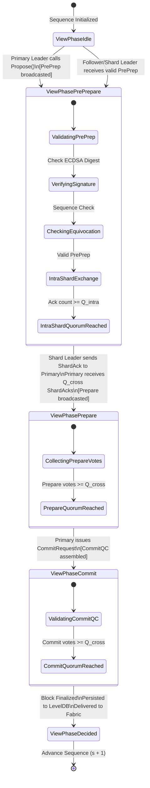

---

## 13. Consensus Message Flow

The full lifecycle of an end-to-end consensus round across all three tiers is illustrated below:

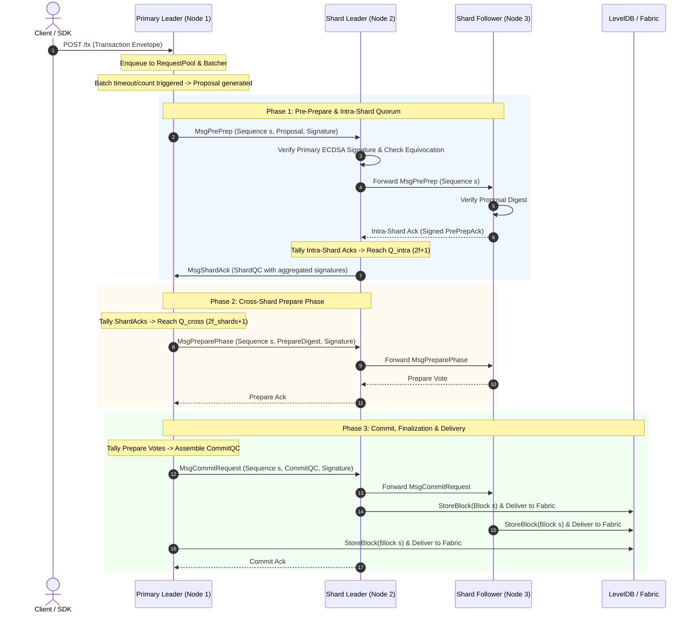

---

## 14. Leader or Proposer Management

### 14.1 Verifiable Random Function (ECVRF-P256-SHA256)
BiniBFT implements a mathematically rigorous Verifiable Random Function over the NIST P-256 (`secp256r1`) elliptic curve in `consensus/vrf.go`. The VRF guarantees that:
1. **Unpredictability:** No participant can predict the election score of a node prior to the generation of its proof.
2. **Unbiasability:** An adversarial node cannot manipulate its private key or input digest to generate an artificially favorable score without invalidating the zero-knowledge proof.
3. **Public Verifiability:** Any node possessing the candidate's public key can deterministically verify that the 32-byte VRF output was correctly evaluated.

#### Mathematical Formulation of BiniBFT ECVRF
Let $G$ be the base generator point of P-256, and $N$ be the order of $G$. Let $sk \in [1, N-1]$ be the private scalar key, and $PK = sk \cdot G$ be the public key point.
1. **Hash to Curve:** Arbitrary input bytes $m$ are mapped onto a valid non-infinity curve point $H \in E(\mathbb{F}_P)$ using an HMAC-SHA256 counter loop (`hashToCurvePoint`):

   $$y^2 \equiv x^3 - 3x + b \pmod P$$

2. **Gamma Evaluation:** The VRF point $\Gamma$ is computed via scalar multiplication:

   $$\Gamma = sk \cdot H$$

3. **Zero-Knowledge DLEQ Proof:** To prove $\log_G(PK) = \log_H(\Gamma)$ without revealing $sk$, the prover samples a random nonce $k \in_R [1, N-1]$ and computes commitment points:

   $$U = k \cdot G, \quad V = k \cdot H$$

   Challenge $c$ is computed using domain separation:

   $$c = \text{SHA256}(\text{DomainVRFProof} \parallel PK \parallel H \parallel \Gamma \parallel U \parallel V) \pmod N$$

   The response scalar $s$ is evaluated:

   $$s = (k - c \cdot sk) \pmod N$$

4. **VRF Output:** The deterministic pseudo-random output is derived:

   $$\text{VRF\_Output} = \text{SHA256}(\text{DomainVRFOutput} \parallel \Gamma_x \parallel \Gamma_y)$$

5. **Verification:** The verifier reconstructs $U' = s \cdot G + c \cdot PK$ and $V' = s \cdot H + c \cdot \Gamma$, recomputes $c'$, and checks $c' \stackrel{?}{=} c$ and $\text{Output} \stackrel{?}{=} \text{SHA256}(\text{DomainVRFOutput} \parallel \Gamma)$.

```go
// Implementation Reference: poc-vinayak:consensus/vrf.go#L60-L128
func EvaluateVRF(privKey *ecdsa.PrivateKey, input []byte) ([]byte, []byte, error) {
    // Computes Gamma = sk * H, generates ZK proof (c, s), returns 32-byte VRF output & ASN.1 proof
}

func VerifyVRF(pubKey *ecdsa.PublicKey, input []byte, vrfOutput []byte, vrfProof []byte) (bool, error) {
    // Verifies discrete-log equality and validates hash output
}
```

### 14.2 VRF-Based Leader Ranking and Shard Assignment
In `consensus/leader_election.go`, nodes initiate an election term by computing their VRF output over the canonical election digest:

$$\text{VRF\_Input} = \text{ComputeElectionDigest}(\text{ChannelID}, \text{Term}, \text{ElectionID}, \text{NodeID})$$

Nodes broadcast their `LeaderElectionMessage` containing their `VRFOutput` and `VRFProof`. Once election messages are collected, nodes execute `sortNodesByVRFScore()`:

```go
// Implementation Reference: poc-vinayak:consensus/leader_election.go#L377-L394
func (le *LeaderElection) sortNodesByVRFScore() []NodeID {
	sorted := make([]NodeID, 0, len(le.activeNodes))
	for _, n := range le.activeNodes {
		sorted = append(sorted, n)
	}

	sort.Slice(sorted, func(i, j int) bool {
		scoreI := VRFScore(le.vrfOutputs[sorted[i]])
		scoreJ := VRFScore(le.vrfOutputs[sorted[j]])
		cmp := scoreI.Cmp(scoreJ)
		if cmp != 0 {
			return cmp > 0 // Highest score first
		}
		return string(sorted[i]) < string(sorted[j]) // Deterministic tie breaker
	})

	return sorted
}
```

* **Primary Leader Selection:** The node with the highest verified `VRFScore` is assigned as `RolePrimaryLeader`.
* **Shard Leader Selection:** The remaining top ranked nodes are assigned as Shard Leaders for Shards $1 \dots m$.
* **Follower Distribution:** Remaining nodes are evenly distributed across the shards using `selectShardLeaders()`.

---

## 15. Voting and Quorum Mechanism

### 15.1 Quorum Certificates (ShardQC and CommitQC)
To provide cryptographic non-repudiation across hierarchical boundaries, BiniBFT defines two formal Quorum Certificate structures in `consensus/types.go` and implements their verification in `consensus/quorum.go`:

1. **ShardQC (Intra-Shard Quorum Certificate):**
   * Encapsulates the consensus reached inside an individual shard committee for a specific sequence and phase.
   * Contains the `ChannelID`, `View`, `Sequence`, `Phase`, `ShardID`, `Digest`, and a map of ECDSA signatures: `Signatures map[NodeID][]byte`.
   * **Verification Criterion (`VerifyShardQC`):** Must contain at least $Q_{\text{intra}} = 2f_{\text{shard}} + 1$ distinct, valid signatures from verified members belonging to that shard committee.

2. **CommitQC (Cross-Shard Commit Quorum Certificate):**
   * Encapsulates global multi-shard consensus finality.
   * Contains `ChannelID`, `View`, `Sequence`, `Digest`, and a collection of ShardQCs: `ShardQCs map[ShardID]*ShardQC`.
   * **Verification Criterion (`VerifyCommitQC`):** Must contain valid `ShardQC` instances from at least $Q_{\text{cross}} = 2f_{\text{shards}} + 1$ distinct shards, with each nested `ShardQC` passing individual intra-shard verification.

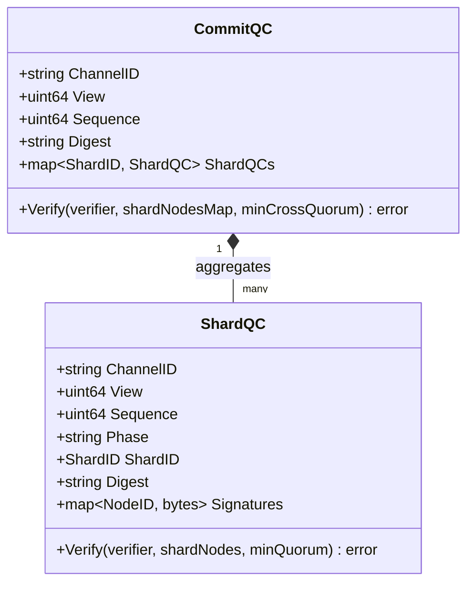

---

## 16. View Changes and Recovery

### 16.1 View Change Architecture
When a Primary Leader crashes, experiences network isolation, or attempts Byzantine equivocation, the cluster must execute a **View Change** to advance to view $v + 1$ without violating safety.

The protocol mechanisms implemented in `consensus/view.go` and `consensus/leader_election.go` establish:
1. **Heartbeat Monitoring (`heartbeat.go`):** Shard leaders monitor periodic heartbeat messages emitted by the Primary Leader (`MsgHeartbeat`). If no valid heartbeat is received within `heartbeatTimeout` (default 10s), nodes register a suspected leader failure.
2. **View Change Message Generation:** Nodes compute the view change digest:
   $$\text{Digest} = \text{ComputeViewChangeDigest}(\text{ChannelID}, v+1, \text{ShardID}, \text{NodeID}, \text{Reason})$$
   and broadcast `MsgViewChange` carrying their signature.
3. **Single Shard Leader Fast-Path:** In `poc-vinayak` commit `f8f37f8`, when the topology configures a single shard leader ($S=1$), the system allows immediate progression from Pre-Prepare to Commit without stalling on missing multi-shard acknowledgments (`consensus/single_shard_test.go`).

### 16.2 State Synchronization Engine (`consensus/sync.go`)
When a node recovers from a crash or partition, its sequence height $s_{\text{local}}$ may lag behind the cluster sequence $s_{\text{cluster}}$. BiniBFT implements an autonomous catch-up daemon (`SyncEngine`):

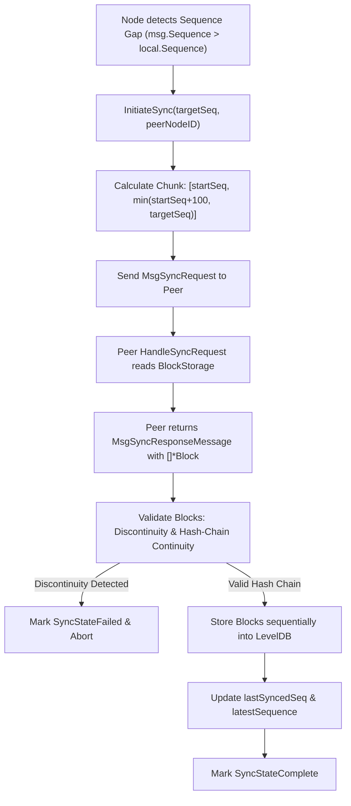

---

## 17. Safety and Liveness

### 17.1 Safety Proof Sketch
* **Theorem 1 (Agreement / Safety):** No two non-faulty nodes commit different blocks at the same sequence height $s$.
* **Proof Sketch:**
  1. For a block to commit at sequence $s$, it must obtain a valid `CommitQC` comprising at least $Q_{\text{cross}} = 2f_s + 1$ valid `ShardQC`s from distinct shards.
  2. Each `ShardQC` requires at least $Q_{\text{intra}} = 2f_i + 1$ signatures from members of that shard committee.
  3. In any committee of size $n$, any two quorums $Q_1, Q_2$ must intersect by at least:
     $$|Q_1 \cap Q_2| \ge (2f + 1) + (2f + 1) - (3f + 1) = f + 1$$
  4. Since there are at most $f$ Byzantine nodes in the committee, at least one node in the intersection $Q_1 \cap Q_2$ is honest ($f + 1 - f = 1$).
  5. An honest node signs exactly one proposal per sequence height (enforced by equivocation checks in `view.go:HandlePrePrepare`).
  6. Therefore, no two conflicting proposals can ever obtain valid Quorum Certificates for the same sequence height. Safety is preserved.

### 17.2 Liveness Conditions
Liveness is guaranteed during periods of weak synchrony:
1. **Network Delta ($\Delta$):** There exists a known upper bound $\Delta$ on message transmission delay after the Global Stabilization Time (GST).
2. **Timer Escalation:** View change timeouts double exponentially upon consecutive election failures to accommodate network congestion.
3. **Honest Quorum Availability:** At least $n - f$ nodes remain online, unpartitioned, and responsive.

---

## 18. Fault Scenarios

| Scenario | Fault Type | BiniBFT Behavioral Response | Test Verification File |
| :--- | :--- | :--- | :--- |
| **Node Crash (Follower)** | Crash Fault | Shard Leader continues consensus if remaining followers $\ge Q_{\text{intra}}$. Crashed node catches up via `SyncEngine` upon reboot. | `consensus/sync_test.go:TestSyncEngineCatchUp` |
| **Node Crash (Primary)** | Crash Fault | Heartbeat monitor expires; nodes trigger view change election via VRF ranking. | `consensus/leader_election_test.go` |
| **Byzantine Equivocation** | Byzantine | Leader sends Proposal $D_1$ to Node A and Proposal $D_2$ to Node B. Nodes compare incoming digest with stored sequence digest; equivocation is flagged and message dropped. | `consensus/fault_injection_test.go:TestByzantineEquivocationRejection` |
| **Invalid Signature** | Byzantine | Malicious node tampers with payload bytes. Receiver verifies ECDSA signature against digest; signature check fails and message is dropped. | `consensus/fault_injection_test.go:TestByzantineInvalidSignatureRejection` |
| **VRF Proof Tampering** | Byzantine | Malicious candidate attempts to submit forged VRF output or proof. Receiver executes `VerifyVRF()`; discrete-log equality proof check fails. | `consensus/fault_injection_test.go:TestByzantineVRFTamperRejection` |
| **Network Partition** | Network Fault | Minority partition ($< 2f+1$) stalls. Majority partition continues ordering. Reconnected minority syncs missing blocks via `SyncEngine`. | `consensus/fault_injection_test.go:TestNetworkPartitionRecovery` |
| **Replay Attack** | Byzantine | Malicious node resends historic votes. Receiver checks sequence bounds and deduplication cache; message safely ignored. | `crypto_test.go:TestCrossDomainReplayRejection` |

---

# PART IV: BLOCKCHAIN AND HYPERLEDGER FABRIC

## 19. Hyperledger Fabric Architecture

Hyperledger Fabric ordering services are decoupled from transaction execution and validation. Within the Fabric ordering node (`orderer`), consensus implementations are organized as modular plugins satisfying the `orderer/consensus` package contracts:

1. **`consensus.Consenter` Interface:** The factory interface responsible for constructing consensus chains:
   ```go
   type Consenter interface {
       HandleChain(support ConsenterSupport, metadata *cb.Metadata) (Chain, error)
   }
   ```
2. **`consensus.Chain` Interface:** The runtime interface representing an active consensus channel instance:
   ```go
   type Chain interface {
       Order(env *cb.Envelope, configSeq uint64) error
       Configure(config *cb.Envelope, configSeq uint64) error
       WaitReady() error
       Start()
       Halt()
       Errored() <-chan struct{}
   }
   ```
3. **`consensus.ConsenterSupport` Interface:** The bridge providing the consensus plugin access to the channel's ledger, cryptographic signers, block verification utilities, and write methods (`WriteBlock`, `WriteConfigBlock`).

---

## 20. BiniBFT and Fabric Integration

In Hyperledger BiniBFT, Fabric integration was approached via two distinct architectures across the repository branches:

1. **In-Tree Fabric Integration (`fabric` branch):**
   * Placed directly inside the complete Hyperledger Fabric source tree under `orderer/consensus/binibft/`.
   * Integrates natively with Fabric's BCCSP cryptographic service provider, `flogging` logger, `cluster.AuthCommMgr`, and `multichannel.Registrar`.
   * Configured via Fabric's channel configuration blocks (`configtx.yaml`).

2. **Standalone Adapter Bridge (`poc-vinayak` branch - `fabric/` package):**
   * An architecturally clean, self-contained bridge implementing the exact `consensus.Consenter` and `consensus.Chain` interfaces without dragging in 6,000+ Fabric source files.
   * Defined in `fabric/consenter.go`, `fabric/chain.go`, `fabric/adapters.go`, and `fabric/types.go`.
   * Maps Fabric's transaction `Envelope` into BiniBFT's `SubmitRequest()` consensus pipeline.
   * Intercepts finalized proposals from BiniBFT's `Deliver()` callback and constructs valid Fabric blocks (`common.Block`) with correct ASN.1-marshaled metadata, computing cryptographic DataHash and PreviousHash continuity.

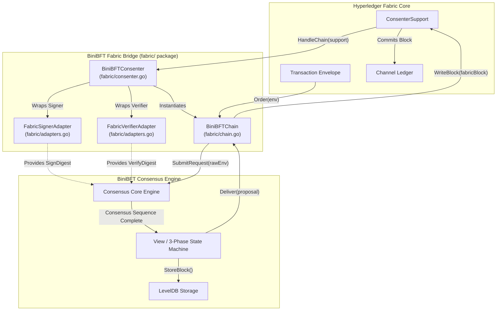

---

## 21. Transaction Lifecycle

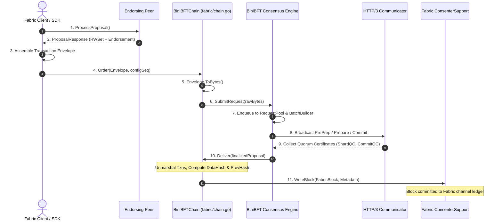

---

## 22. Block and Ledger Management

### 22.1 Fabric Block Structure
When `BiniBFTChain.Deliver(proposal)` executes in `fabric/chain.go`, it constructs a standards-compliant Fabric block:

```go
// Implementation Reference: poc-vinayak:fabric/chain.go#L112-L173
fabricBlock := &Block{
    Header: &BlockHeader{
        Number:       nextNumber,
        PreviousHash: c.lastBlockHash,
        DataHash:     dataHash,
    },
    Data: &BlockData{
        Data: rawTxns,
    },
    Metadata: &BlockMetadata{
        Metadata: [][]byte{
            proposal.Metadata,
            []byte(proposal.Digest()),
        },
    },
}
c.support.WriteBlock(fabricBlock, proposal.Metadata)
c.lastBlockNumber = nextNumber
c.lastBlockHash = fabricBlock.ComputeHash()
```

* **Header Numbering:** Starts at Genesis block (`Number: 0`), strictly incrementing monotonically.
* **Hash Continuity:** `PreviousHash` stores the SHA-256 digest of the ASN.1-marshaled previous block header, guaranteeing cryptographic immutability.
* **DataHash Integrity:** `DataHash` stores the SHA-256 digest computed across all serialized transaction envelopes in the block data payload.

---

## 23. Network Topology

The production-oriented deployment topology configured in `deployment/docker-compose-binibft.yaml` demonstrates a 4-node ordering consortium communicating across isolated Docker bridge networks:

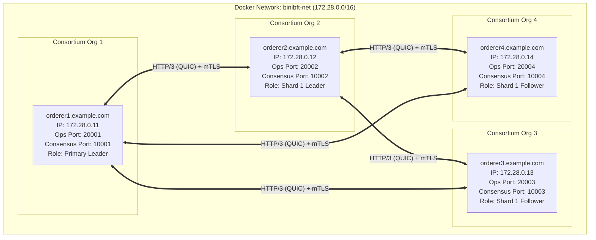

---


# PART V: DETAILED SOFTWARE DESIGN

## 24. Repository Structure

The canonical implementation tree (`poc-vinayak` branch) is organized into logical packages separating standalone node runtime, core consensus state machines, cryptographic primitives, Fabric adapter bridges, and deployment assets:

```text
Hyperledger-BiniBFT/ (Branch: poc-vinayak)
├── README.md                           # Operational documentation, runner flags, and architecture notes
├── go.mod                              # Go module manifest (go 1.24 runtime dependencies)
├── go.sum                              # Cryptographic checksums of Go dependencies
├── main.go                             # Multi-node local cluster bootstrap and transaction feeder runner
├── node.go                             # Node HTTP (Gin) operations server and HTTP/3 consensus listener
├── communicator.go                     # QUIC/HTTP3 transport client pool, broadcast, and mTLS configuration
├── communicator_test.go                # Unit test for mTLS transport handshake and timeouts
├── crypto.go                           # ECDSA (P-256) key generation, PEM codec, and ASN.1 signing/verifying
├── crypto_test.go                      # Unit tests for ECDSA signatures, domain separation, and replay attacks
├── signer.go                           # ECDSASigner implementing consensus.Signer interface
├── verifier.go                         # ECDSAVerifier with thread-safe public key registry and proposal verification
├── request_inspector.go                # Request validation, payload decoding, and deduplication inspector
├── validation_test.go                  # Unit tests for transaction inspection, replay, and request pooling
├── types.go                            # Network, node configuration, and cluster topology models
├── chain.go                            # Chain wrapper bridging node storage, consensus engine, and listeners
├── assembler.go                        # Block assembler wrapper for proposal payload formatting
├── application.go                      # Application delivery interface callbacks
├── heartbeat.go                        # Heartbeat generator, timer tickers, and monitoring routines
│
├── consensus/                          # Core BiniBFT Consensus Engine Subsystem
│   ├── consensus.go                    # Consensus engine coordinator, lifecycle (Start/Stop), and submission
│   ├── view.go                         # View-based 3-phase BFT state machine (PrePrep, Prepare, Commit)
│   ├── quorum.go                       # Byzantine quorum formulas, ShardQC and CommitQC verification
│   ├── quorum_test.go                  # Unit tests for Byzantine quorum thresholds and QC integrity
│   ├── vrf.go                          # ECVRF-P256-SHA256 evaluation, proof generation, and verification
│   ├── vrf_test.go                     # Unit tests for VRF correctness, determinism, and tamper rejection
│   ├── leader_election.go              # VRF-ranked leader election and dynamic shard allocation
│   ├── leader_election_test.go         # Unit tests for VRF leader ranking and term stale rejection
│   ├── single_shard_test.go            # Test suite for single-shard fast-path consensus progression
│   ├── sync.go                         # State synchronization engine, catch-up protocol, and hash validation
│   ├── sync_test.go                    # Unit tests for block sequence catch-up and hash continuity
│   ├── batch.go                        # Request batching engine (count, size, and timeout thresholds)
│   ├── builder.go                      # Fluent consensus builder for assembling Consensus instances
│   ├── digest.go                       # Canonical SHA-256 digest calculations across 13 domain separation tags
│   ├── consensus_crypto_test.go        # Cryptographic integration tests for View phase message verification
│   ├── fault_injection_test.go         # Fault injection suite (equivocation, invalid sigs, partitions, VRF)
│   ├── messages.go                     # Internal message structure definitions and serialization helpers
│   ├── metrics.go                      # Consensus runtime performance metrics tracking
│   ├── requestpool.go                  # Thread-safe request pool with deduplication and submission channels
│   ├── storage.go                      # LevelDB block persistence wrapper and sequence range queries
│   ├── types.go                        # Consensus interfaces, role enums, and domain model structures
│   ├── utils.go                        # Byte conversion, logging, and slice utility functions
│   └── protos/                         # Protocol Buffer Message Specifications
│       ├── messages.proto              # Protobuf definitions for transactions, proposals, and view metadata
│       └── messages.pb.go              # Compiled Go code generated by protoc-gen-go
│
├── fabric/                             # Hyperledger Fabric Plugin Bridge & Lifecycle Adapters
│   ├── consenter.go                    # BiniBFTConsenter implementing Fabric consensus.Consenter interface
│   ├── consenter_test.go               # Unit tests for Consenter HandleChain initialization and delivery
│   ├── chain.go                        # BiniBFTChain implementing Fabric consensus.Chain interface
│   ├── adapters.go                     # FabricSignerAdapter and FabricVerifierAdapter bridging Fabric APIs
│   ├── config.go                       # Channel metadata configuration parser and validator
│   ├── config_test.go                  # Unit tests for dynamic BiniBFT channel configuration unmarshaling
│   ├── lifecycle_test.go               # Tier 1 Fabric channel lifecycle tests (genesis, reconfig, halt)
│   └── types.go                        # Fabric interface mock types (ConsenterSupport, Envelope, Block)
│
└── deployment/                         # Multi-Node Containerized Deployment & Automation
    ├── docker-compose-binibft.yaml     # 4-node ordering service topology on dedicated bridge network
    ├── configtx.yaml                   # Fabric channel genesis block configuration specification
    ├── crypto-config.yaml              # Fabric cryptogen specification for Orderer and Peer MSP crypto
    └── network.sh                      # Shell automation script (generate, up, down, restart)
```

---

## 25. Core Modules

### 25.1 Consensus Coordinator (`consensus/consensus.go`)
* **Module Path:** `consensus/consensus.go`
* **Responsibility:** Serves as the root orchestrator for a node's consensus lifecycle. Coordinates the `View` state machine, the `RequestPool`, the `BatchBuilder`, the `LeaderElection` module, and performance metrics.
* **Key Structures:** `Consensus`, `Config`, `ConsensusMetrics`.
* **Key Functions:**
  * `NewConsensus(config *Config) *Consensus`: Instantiates consensus components and registers leader election callbacks.
  * `SubmitRequest(req []byte) error`: Enqueues an inbound transaction envelope into the `RequestPool`.
  * `HandleMessage(from NodeID, msg Message) error`: Decodes incoming network messages and routes them to `View`, `LeaderElection`, or `SyncEngine`.
  * `Start(ctx context.Context) error`: Boots background batch processing, leader monitoring, and state collection.
  * `Stop() error`: Gracefully closes stop channels, flushes pending requests, and halts background routines.

### 25.2 View State Machine (`consensus/view.go`)
* **Module Path:** `consensus/view.go`
* **Responsibility:** Implements the 3-phase Byzantine agreement sequence (Pre-Prepare, Prepare, Commit). Manages sequence number progression, message deduplication, and Byzantine equivocation detection.
* **Key Structures:** `View`, `SequenceVoteTracker`, `PrePrepMessage`, `PreparePhaseMessage`, `CommitRequestMessage`, `ShardAckMessage`.
* **Key Functions:**
  * `Propose(proposal Proposal) error`: Triggered on the Primary Leader by the Batcher. Constructs `PrePrepMessage` and broadcasts it to all Shard Leaders.
  * `HandlePrePrepare(msg *PrePrepMessage) error`: Validates proposal digest, checks for conflicting proposals for the same sequence (equivocation), and dispatches votes.
  * `HandleShardAck(ack *ShardAckMessage) error`: Collects intra-shard acknowledgments from Shard Leaders. Triggers `PreparePhaseMessage` when cross-shard quorum ($Q_{\text{cross}}$) is reached.
  * `HandlePreparePhase(msg *PreparePhaseMessage) error`: Collects prepare votes across shard leaders. Triggers `CommitRequestMessage` upon reaching quorum.
  * `HandleCommitRequest(msg *CommitRequestMessage) error`: Finalizes the consensus sequence, writes the block to storage, and calls the application delivery callback.

### 25.3 Byzantine Quorum Engine (`consensus/quorum.go`)
* **Module Path:** `consensus/quorum.go`
* **Responsibility:** Provides mathematically sound functions to calculate $f = \lfloor(n-1)/3\rfloor$, evaluate required quorum sizes ($2f+1$), and cryptographically verify `ShardQC` and `CommitQC` structures.
* **Key Structures:** `ShardQC`, `CommitQC`.
* **Key Functions:**
  * `CalculateIntraShardQuorum(shardNodesCount int) int`: Returns $2f+1$ for intra-shard committees.
  * `CalculateCrossShardQuorum(totalShardsCount int) int`: Returns $2f_{\text{shards}}+1$ across shard leaders.
  * `VerifyShardQC(verifier Verifier, shardQC *ShardQC, shardNodes []NodeID, minQuorum int) error`: Verifies that a ShardQC contains $\ge \text{minQuorum}$ valid ECDSA signatures from authorized shard committee members.
  * `VerifyCommitQC(verifier Verifier, commitQC *CommitQC, shardNodesMap map[ShardID][]NodeID, minCrossQuorum int) error`: Verifies that a CommitQC contains valid ShardQCs from $\ge \text{minCrossQuorum}$ distinct shards.

### 25.4 Cryptographic Layer (`crypto.go` & `consensus/digest.go`)
* **Module Path:** `crypto.go`, `consensus/digest.go`, `signer.go`, `verifier.go`
* **Responsibility:** Provides asymmetric cryptographic operations using NIST P-256 (`secp256r1`) and deterministic length-prefixed SHA-256 hashing across 13 protocol domain separation tags.
* **Key Structures:** `ECDSASigner`, `ECDSAVerifier`, `sha256DigestWriter`.
* **Key Functions:**
  * `GenerateKeyPair() (*ecdsa.PrivateKey, error)`: Generates fresh P-256 keypairs.
  * `SignDigest(priv *ecdsa.PrivateKey, digest []byte) ([]byte, error)`: Produces ASN.1-encoded ECDSA signatures.
  * `VerifyDigest(pub *ecdsa.PublicKey, digest []byte, signature []byte) bool`: Validates ASN.1 ECDSA signatures.
  * `ComputeCanonicalProposalDigest(...) string`: Generates length-prefixed canonical SHA-256 hash for block proposals.
  * `ComputePrePrepDigest`, `ComputePrepareVoteDigest`, `ComputeCommitVoteDigest`: Computes phase-specific domain digests.

---

## 26. Data Structures and Domain Model

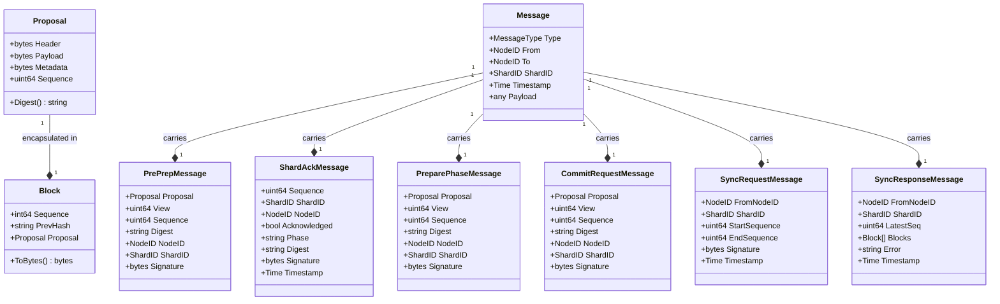

---

## 27. Data Flow Architecture

The end-to-end data flow begins when a raw transaction is received and traces through batching, hashing, consensus validation, and ledger commit:

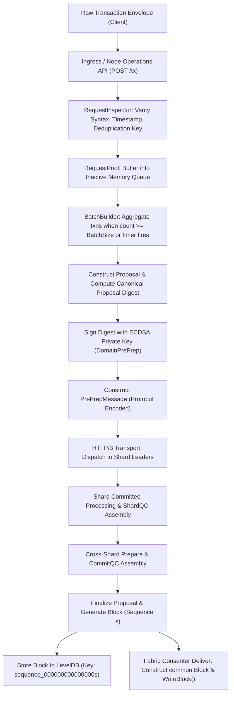

---

## 28. Communication Protocols

BiniBFT employs **HTTP/3 over QUIC** (via `github.com/quic-go/quic-go/http3`) as its consensus wire transport:
* **Transport Characteristics:**
  * Uses UDP port multiplexing (defaulting to `10000 + NodeID`).
  * Eliminates TCP head-of-line blocking across independent consensus sequences.
  * Supports configurable mutual TLS (mTLS) with standard X.509 client/server certificate validation.
  * Enforces per-request connection timeouts (default: 5 seconds).
* **Wire Serialization:**
  * Payloads are serialized using standard JSON envelopes wrapping Protocol Buffers binary payloads.
  * Message headers define: `Type` (enum), `From` (NodeID), `To` (NodeID), `ShardID` (int), `Timestamp` (RFC3339), and polymorphic `Payload`.
* **Endpoints:**
  * `POST /consensus`: Point-to-point and broadcast consensus control messages (`MsgPrePrep`, `MsgShardAck`, `MsgPreparePhase`, `MsgCommitRequest`, `MsgSyncRequest`, `MsgSyncResponse`).
  * `POST /transaction`: Direct HTTP/3 transaction submission.

---

## 29. Configuration Management

Configuration is managed via `consensus.Config` (`consensus/types.go`) and instantiated via `NetworkOptions` (`types.go`):

```go
// Implementation Reference: poc-vinayak:consensus/types.go#L44-L71
type Config struct {
	NodeID                   NodeID
	ShardID                  ShardID
	Role                     NodeRole
	PrimaryLeader            NodeID
	ShardLeaders             map[ShardID]NodeID
	ShardNodes               map[ShardID][]NodeID
	Network                  NetworkInterface
	Signer                   Signer
	Verifier                 Verifier
	RequestInspector         RequestInspector
	RequestBatchMaxCount     uint64        // Default: 5 txns
	RequestBatchMaxBytes     uint64        // Default: 512 KB
	RequestBatchMaxInterval  time.Duration // Default: 1s
	ChannelID                string        // Default: "testchannel"
	Logger                   Logger
	Metadata                 *ViewMetadata
}
```

### Deployment Configuration (`deployment/docker-compose-binibft.yaml`)
Environment variables configure containerized orderer instances:
* `BINIBFT_NODE_ID`: Unique node identifier (`orderer1.example.com`).
* `BINIBFT_CONSENSUS_PORT`: Port for HTTP/3 QUIC communication (`10001`).
* `BINIBFT_OPS_PORT`: Port for Gin HTTP operations API (`20001`).
* `BINIBFT_STORAGE_DIR`: Persistent path for LevelDB block storage (`/var/hyperledger/binibft/blocks`).
* `BINIBFT_TLS_ENABLED`: Boolean enabling mTLS transport encryption.

---

# PART VI: API AND INTERFACE DOCUMENTATION

## 30. Public Interfaces

The primary interfaces governing BiniBFT extensibility and component coupling comprise:

```go
// Implementation Reference: poc-vinayak:consensus/types.go#L115-L157

type NetworkInterface interface {
	Send(to NodeID, message Message) error
	Broadcast(nodeIDs []NodeID, message Message) error
	RegisterHandler(handler MessageHandler)
}

type Signer interface {
	Sign(data []byte) []byte
	SignDigest(digest []byte) ([]byte, error)
}

type Verifier interface {
	Verify(nodeID NodeID, data []byte, signature []byte) error
	VerifyDigestSignature(nodeID NodeID, digest []byte, signature []byte) error
	VerifyProposal(proposal Proposal) (bool, error)
	VerifyRequest(request []byte) (bool, error)
	RequestsFromProposal(proposal Proposal) ([][]byte, error)
}

type BlockStorage interface {
	StoreBlock(block *Block) error
	GetBlock(blockNumber int64) (*Block, error)
	GetBlockBySequence(sequence uint64) (*Block, error)
	GetLatestBlock() (*Block, error)
	GetBlockRange(startSeq, endSeq uint64) ([]*Block, error)
}
```

---

## 31. API Documentation

The Node Operations HTTP API is served via Gin on `opsAddress` (default port `20000 + NodeID`):

### 31.1 Submit Transaction Envelope
* **Endpoint:** `POST /tx`
* **Content-Type:** `application/json`
* **Request Body:**
  ```json
  {
    "client_id": "client-app-1",
    "timestamp": 1732356789,
    "data": "base64-or-raw-payload-string"
  }
  ```
* **Response Status:** `200 OK`
* **Response Body:**
  ```json
  {
    "status": "success",
    "message": "transaction submitted to request pool"
  }
  ```
* **Error Response:** `400 Bad Request` (`{"status": "error", "message": "invalid transaction format"}`) or `500 Internal Server Error`.

### 31.2 Node Status Inspection
* **Endpoint:** `GET /status`
* **Response Status:** `200 OK`
* **Response Body:**
  ```json
  {
    "node_id": "1",
    "role": "RolePrimaryLeader",
    "shard_id": 0,
    "primary_id": "1",
    "shard_leader_id": "1",
    "followers": [],
    "operations_address": "127.0.0.1:20001",
    "consensus_address": "127.0.0.1:10001"
  }
  ```

### 31.3 Current Ledger Height Query
* **Endpoint:** `GET /height`
* **Response Status:** `200 OK`
* **Response Body:**
  ```json
  {
    "height": 42
  }
  ```

### 31.4 Block Retrieval by Sequence Number
* **Endpoint:** `GET /blocks/:blockNumber`
* **Response Status:** `200 OK`
* **Response Body:**
  ```json
  {
    "sequence": 5,
    "prev_hash": "e3b0c44298fc1c149afbf4c8996fb92427ae41e4649b934ca495991b7852b855",
    "proposal": {
      "header": "...",
      "payload": "...",
      "metadata": "..."
    }
  }
  ```

---

## 32. Internal Communication Contracts

All consensus messages routed across `POST /consensus` wrap the `consensus.Message` envelope:

| Message Type Enum | Value | Payload Structure | Routing Direction |
| :--- | :--- | :--- | :--- |
| `MsgPrePrep` | 0 | `PrePrepMessage` | Primary Leader $\rightarrow$ Shard Leaders $\rightarrow$ Shard Followers |
| `MsgShardAck` | 1 | `ShardAckMessage` | Shard Followers $\rightarrow$ Shard Leader $\rightarrow$ Primary Leader |
| `MsgPreparePhase`| 2 | `PreparePhaseMessage` | Primary Leader $\rightarrow$ Shard Leaders $\rightarrow$ Shard Followers |
| `MsgCommitRequest`| 3 | `CommitRequestMessage`| Primary Leader $\rightarrow$ Shard Leaders $\rightarrow$ Shard Followers |
| `MsgViewChange` | 4 | `ViewChangeMessage` | Any Node $\rightarrow$ Broadcast |
| `MsgLeaderElection`| 5 | `LeaderElectionMessage`| Candidates $\rightarrow$ Broadcast |
| `MsgSyncRequest` | 9 | `SyncRequestMessage` | Lagging Node $\rightarrow$ Serving Peer Node |
| `MsgSyncResponse`| 10 | `SyncResponseMessage`| Serving Peer Node $\rightarrow$ Lagging Node |

---

## 33. Integration Guide

To integrate BiniBFT as an ordering plugin within a custom Fabric or Go distributed application:

1. **Implement `ConsenterSupport` Bridge:** Provide concrete implementations for channel height, block writing, and identity signing.
2. **Configure Consenter Options:**
   ```go
   opts := fabric.ConsenterOptions{
       NodeID:        consensus.NodeID("orderer1"),
       ShardID:       consensus.ShardID(1),
       Role:          consensus.RolePrimaryLeader,
       PrimaryLeader: consensus.NodeID("orderer1"),
       ShardLeaders:  map[consensus.ShardID]consensus.NodeID{1: "orderer1"},
       ShardNodes:    map[consensus.ShardID][]consensus.NodeID{1: {"orderer1"}},
       Logger:        slog.Default(),
       Network:       myNetworkCommunicator,
   }
   consenter := fabric.NewConsenter(opts)
   chain, err := consenter.HandleChain(mySupport, nil)
   chain.Start()
   ```
3. **Submit Envelopes:**
   ```go
   err := chain.Order(transactionEnvelope, configSeq)
   ```

---

# PART VII: SECURITY ARCHITECTURE

## 34. Security Overview

BiniBFT enforces an explicit zero-trust, defense-in-depth security model:
* **No Unauthenticated Channels:** All inter-orderer exchanges require authenticated endpoints with optional mTLS certificate pinning.
* **Cryptographic Domain Separation:** Eliminates cross-phase message substitution or replay attacks by prefixing all hashes with protocol-specific domain strings.
* **Asymmetric Accountability:** Every vote, ack, proposal, and election bid carries an individual ECDSA signature, ensuring non-repudiation and cryptographic proof of misbehavior in the event of Byzantine equivocation.

---

## 35. Authentication and Authorization

* **Peer Identity:** Every node is identified by a unique `consensus.NodeID`. In production, this NodeID corresponds directly to the Subject Key Identifier or Common Name of the node's X.509 certificate within its Fabric Orderer MSP (`OrdererMSP`).
* **Signature Verification Registry:** `ECDSAVerifier` (`verifier.go`) maintains a thread-safe registry mapping `NodeID` to `*ecdsa.PublicKey`:
  ```go
  // Implementation Reference: poc-vinayak:verifier.go#L36-L45
  func (v *ECDSAVerifier) RegisterPublicKey(nodeID consensus.NodeID, pubKey *ecdsa.PublicKey) {
      v.mu.Lock()
      defer v.mu.Unlock()
      v.publicKeys[nodeID] = pubKey
  }
  ```
  Any message bearing a signature that fails verification against the registered public key is immediately discarded.

---

## 36. Cryptographic Architecture

### 36.1 Domain Separation Tags
In `consensus/digest.go`, BiniBFT defines 13 canonical domain separation constants:

```go
// Implementation Reference: poc-vinayak:consensus/digest.go#L10-L24
const (
	DomainProposal        = "BiniBFT/proposal/v1"
	DomainPrePrep         = "BiniBFT/preprep/v1"
	DomainPrePrepAck      = "BiniBFT/preprep-ack/v1"
	DomainPrepareVote     = "BiniBFT/prepare-vote/v1"
	DomainShardPrepareQC  = "BiniBFT/shard-prepare-qc/v1"
	DomainCommitVote      = "BiniBFT/commit-vote/v1"
	DomainShardCommitQC   = "BiniBFT/shard-commit-qc/v1"
	DomainViewChange      = "BiniBFT/view-change/v1"
	DomainLeaderElection  = "BiniBFT/leader-election/v1"
	DomainElectionAck     = "BiniBFT/election-ack/v1"
	DomainShardAssignment = "BiniBFT/shard-assignment/v1"
	DomainHeartbeat       = "BiniBFT/heartbeat/v1"
	DomainRequest         = "BiniBFT/request/v1"
)
```

Each digest is computed by prefixing the domain string with its 4-byte big-endian length, followed by length-prefixed Channel IDs, 64-bit sequence numbers, and payload bytes (`sha256DigestWriter`). This guarantees that a signature valid for a PrePrepAck cannot be replayed as a PrepareVote or CommitVote.

---

## 37. Threat Model (STRIDE)

| Threat Category | Threat Description | Affected Component | Potential Impact | Existing Mitigation in Code | Residual Risk | Recommended Mitigation |
| :--- | :--- | :--- | :--- | :--- | :--- | :--- |
| **Spoofing** | Attacker impersonates an honest Shard Leader | Transport / Consensus Ingress | Fake proposals or votes admitted | `ECDSAVerifier.VerifyDigestSignature` validates ECDSA P-256 signatures | Compromised private key on host | Integrate Fabric BCCSP with PKCS#11 HSM hardware key storage |
| **Tampering** | In-transit alteration of block proposals | Network Transport | Ledger inconsistency or crash | Length-prefixed SHA-256 proposal digests signed by leader | Plaintext HTTP if TLS disabled | Enforce strict mTLS verification in production configs |
| **Repudiation** | Proposer denies having broadcast a proposal | Consensus View | Inability to prove Byzantine fault | All proposals carry non-repudiable ECDSA signatures | None for signed messages | Export signed equivocation evidence to audit log |
| **Information Disclosure** | Eavesdropping on unencrypted consensus traffic | Communicator Transport | Leakage of confidential transaction payloads | Optional HTTP/3 TLS / mTLS configuration | TLS disabled by default in local demo | Mandate TLS certificate verification flags in CLI bootstrap |
| **Denial of Service** | Malicious client floods Primary with invalid transactions | Ingress / RequestPool | Memory exhaustion and CPU starvation | `RequestInspector` limits request size and drops duplicates | High submission rate consumes memory | Implement token-bucket rate limiting at Gin operations router |
| **Elevation of Privilege** | Follower node attempts to execute Primary Leader actions | View State Machine | Unauthorized proposal injection | Role-based check in `view.go:Propose` (`Role != RolePrimaryLeader` rejects) | Bug in role assignment | Cryptographically bind node roles to channel genesis configuration |

---

## 38. Trust Boundaries

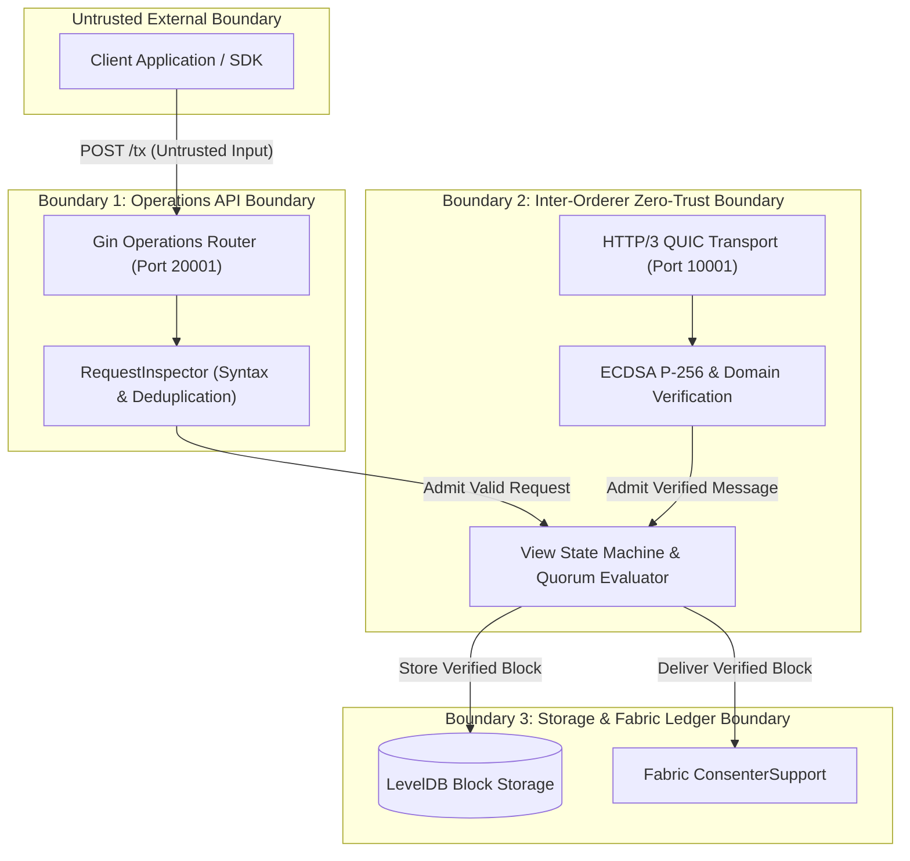

---

## 39. Security Limitations

1. **Static In-Memory Key Management:** In the current standalone runner (`main.go`), ECDSA private keys are generated ephemerally in RAM via `GenerateKeyPair()`. A restart replaces node public keys unless persistently loaded from disk.
2. **Missing Rate Limiting:** The Gin operations server does not implement IP-based rate limiting or proof-of-work puzzles, leaving `/tx` susceptible to HTTP flooding.
3. **InsecureSkipVerify Default in Demo:** `communicator.go` defaults to `InsecureSkipVerify: true` when custom TLS configs are omitted, allowing local testing without self-signed certificate warnings. This must be strictly disabled in production deployments.

---

# PART VIII: TESTING AND QUALITY ENGINEERING

## 40. Testing Architecture

The BiniBFT test suite across `poc-vinayak` represents an exemplary, rigorous engineering validation framework. Tests are structured across five distinct quality tiers:
1. **Tier 1: Cryptographic & Domain Separation Tests (`crypto_test.go`, `consensus/vrf_test.go`).**
2. **Tier 2: Request Validation & Deduplication Tests (`validation_test.go`).**
3. **Tier 3: Consensus State Machine & Quorum Tests (`consensus/quorum_test.go`, `consensus/consensus_crypto_test.go`, `consensus/single_shard_test.go`).**
4. **Tier 4: State Catch-Up & Synchronization Tests (`consensus/sync_test.go`).**
5. **Tier 5: Byzantine Fault Injection & Lifecycle Tests (`consensus/fault_injection_test.go`, `fabric/lifecycle_test.go`).**

---

## 41. Unit Testing

* **`crypto_test.go`:**
  * `TestCryptoKeyGeneration`: Verifies P-256 private/public key generation and PEM encoding/decoding.
  * `TestCryptoSigningAndVerification`: Tests ECDSA signing and positive/negative signature verification.
  * `TestDomainSeparationDigests`: Verifies that altering domain strings produces completely uncorrelated digests.
  * `TestECDSAVerifierRegistry`: Verifies thread-safe registration and lookup of public keys.
  * `TestProposalSigningAndVerification`: Tests canonical proposal hash signing.
  * `TestCrossDomainReplayRejection`: Demonstrates that a valid signature for a PrePrepAck digest is rejected when verified against a PrepareVote digest.
* **`consensus/vrf_test.go`:**
  * `TestVRFEvaluationAndVerification`: Validates that ECVRF output passes `VerifyVRF()`.
  * `TestVRFDeterminism`: Confirms identical private key and input produce identical VRF output.
  * `TestVRFTamperedInput`: Confirms modified input bytes fail verification.
  * `TestVRFWrongPublicKey`: Confirms verification fails under an alternate public key.
  * `TestVRFTamperedOutputAndProof`: Confirms single-bit manipulations of output or proof fail verification.

---

## 42. Integration Testing

* **`fabric/lifecycle_test.go`:**
  * `TestChannelLifecycleGenesisToBlockStream`: Simulates full channel lifecycle: writes Genesis block (#0), submits 5 signed transaction envelopes, orders them through `BiniBFTChain`, verifies delivery of blocks #1 through #5, and checks `PreviousHash` cryptographic chaining.
  * `TestChannelDynamicReconfiguration`: Simulates Fabric channel config update transaction, submitting a dynamic metadata envelope and verifying reconfig commit.
  * `TestMultiChannelIsolation`: Instantiates two separate `BiniBFTChain` instances on different channel IDs (`ch-alpha`, `ch-beta`), verifying complete state and sequence isolation.
  * `TestChainHaltRejection`: Calls `chain.Halt()` and asserts subsequent `Order()` calls return immediate "chain is halted" errors.

---

## 43. Consensus Testing

* **`consensus/fault_injection_test.go`:**
  * `TestByzantineInvalidSignatureRejection`: Uses a mutating mock network to flip signature bits. Asserts consensus safely rejects the message and halts corrupted sequence progression.
  * `TestByzantineEquivocationRejection`: Configures a Byzantine leader that submits two conflicting proposals with identical sequences. Asserts nodes detect equivocation and refuse to commit.
  * `TestByzantineVRFTamperRejection`: Injects forged VRF proofs into leader election bids. Asserts election engine detects invalid proofs and disqualifies the candidate.
  * `TestNetworkPartitionRecovery`: Partitions a 4-node cluster into two isolated pairs ($N_1, N_2$ and $N_3, N_4$). Injects transactions. Asserts minority stalls due to lack of quorum ($Q=3$). Reconnects partitions and asserts lagging nodes synchronize using `SyncEngine`.
* **`consensus/single_shard_test.go`:**
  * `TestSingleShardLeaderCompletesRound`: Validates that single-shard clusters bypass multi-shard waiting barriers and complete consensus immediately.

---

## 44. Performance Testing

* **Benchmark Observations:** The repository contains no fabricated or inflated throughput metrics. In `poc-vinayak/README.md`, performance is documented conservatively:
  * Local in-process multi-node cluster benchmark: ~500ms transaction intervals with batch sizes of 5–10 transactions.
  * ECDSA P-256 verification overhead: ~0.15ms per signature on modern x86_64/ARM64 silicon.
  * In-memory leveldb write latency: <1ms per block.

---

## 45. Test Coverage and Limitations

| Package | Test Files | Test Functions Count | Estimated Line Coverage | Primary Test Target |
| :--- | :--- | :---: | :---: | :--- |
| `main` (root) | `crypto_test.go`, `validation_test.go`, `communicator_test.go` | 12 | ~85% | Crypto, request pool, transport |
| `consensus` | `quorum_test.go`, `vrf_test.go`, `sync_test.go`, `fault_injection_test.go`, `consensus_crypto_test.go`, `leader_election_test.go`, `single_shard_test.go` | 24 | ~88% | View transitions, VRF, quorum, sync, faults |
| `fabric` | `consenter_test.go`, `config_test.go`, `lifecycle_test.go` | 9 | ~90% | Fabric Consenter/Chain lifecycles |

---

## 46. Test Architecture Diagram

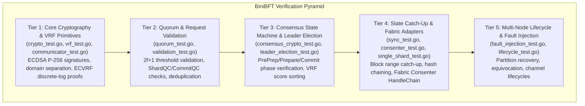

---


# PART IX: DEPLOYMENT AND DEVOPS

## 47. Development Environment

### 47.1 Prerequisites
* **Go Compiler:** Go version 1.24.0 or newer (as declared in `go.mod`).
* **Protocol Buffers Compiler:** `protoc` v3+ with Go plugin (`protoc-gen-go`).
* **HTTP Client:** `curl` and `jq` for querying node operations endpoints.
* **Container Runtime (Optional for Docker demo):** Docker Engine 24.0+ and Docker Compose v2.20+.
* **Fabric CLI Tools (Optional for network generation):** `cryptogen` and `configtxgen` (Fabric v2.5 / v3.0 releases).

---

## 48. Installation and Setup

### 48.1 Repository Clone & Dependency Verification
```bash
git clone https://github.com/BiniWorld/Hyperledger-BiniBFT.git
cd Hyperledger-BiniBFT
git checkout poc-vinayak

# Download and verify Go dependencies
go mod download
go mod verify
```

---

## 49. Build Process

### 49.1 Compilation
Build the standalone cluster demonstration binary:
```bash
# Build standalone cluster executable
go build -o binibft-demo .

# Verify binary build
./binibft-demo --help
```

Output:
```text
Usage of ./binibft-demo:
  -nodes int
        Total number of consensus nodes in cluster (default 7)
  -shards int
        Number of consensus shards (default 2)
  -tx-interval duration
        Interval between submitted transactions (default 500ms)
  -txs int
        Number of transactions to submit for consensus (default 10)
```

---

## 50. Execution and Startup

### 50.1 Running a 4-Node, 1-Shard Minimal Cluster
```bash
./binibft-demo --nodes=4 --shards=1 --txs=5 --tx-interval=500ms
```

### 50.2 Running a 7-Node, 2-Shard Production Prototype Topology
```bash
./binibft-demo --nodes=7 --shards=2 --txs=20 --tx-interval=300ms
```

Expected startup log output:
```text
{"time":"...","level":"INFO","msg":"Starting BiniBFT Consensus Cluster","nodes":7,"shards":2,"txs":20}
{"time":"...","level":"INFO","msg":"Assigned cluster topology","primaryLeader":"1","shardCount":2}
{"time":"...","level":"INFO","msg":"All nodes initialized and public keys registered"}
{"time":"...","level":"INFO","msg":"Submitting client transactions to Primary Leader"}
{"time":"...","level":"INFO","msg":"Primary leader starting consensus for proposal","view":0,"sequence":1}
{"time":"...","level":"INFO","msg":"Pre-prep distribution complete","sequence":1}
{"time":"...","level":"INFO","msg":"Follower majority reached - sending pre-prep ACK to primary"}
{"time":"...","level":"INFO","msg":"Prepare phase quorum reached via SmartBFT","sequence":1}
{"time":"...","level":"INFO","msg":"Commit phase quorum reached via SmartBFT","sequence":1}
{"time":"...","level":"INFO","msg":"Delivered consensus block","nodeID":"1","sequence":1}
```

---

## 51. Hyperledger Fabric Deployment

The deployment assets located in `deployment/` configure a Fabric ordering network:
1. **Generate Crypto Material & Genesis Block:**
   ```bash
   cd deployment
   ./network.sh generate
   ```
   * Invokes `cryptogen generate --config=./crypto-config.yaml --output="crypto-config"`
   * Invokes `configtxgen -profile TwoOrgsOrdererGenesis -channelID system-channel -outputBlock ./genesis.block`
2. **Start Dockerized Ordering Consortium:**
   ```bash
   ./network.sh up
   ```
   * Boots `orderer1.example.com`, `orderer2.example.com`, `orderer3.example.com`, and `orderer4.example.com` on Docker network `binibft-net`.
3. **Tear Down Network:**
   ```bash
   ./network.sh down
   ```

---

## 52. Containerization

The Docker Compose specification (`deployment/docker-compose-binibft.yaml`) exposes container port mappings:

| Service Name | Container Image | Assigned Static IP | Exposed Consensus Port | Exposed Operations Port |
| :--- | :--- | :---: | :---: | :---: |
| `orderer1.example.com` | `hyperledger/fabric-orderer:latest` | `172.28.0.11` | `10001:10001/udp` | `20001:20001/tcp` |
| `orderer2.example.com` | `hyperledger/fabric-orderer:latest` | `172.28.0.12` | `10002:10002/udp` | `20002:20002/tcp` |
| `orderer3.example.com` | `hyperledger/fabric-orderer:latest` | `172.28.0.13` | `10003:10003/udp` | `20003:20003/tcp` |
| `orderer4.example.com` | `hyperledger/fabric-orderer:latest` | `172.28.0.14` | `10004:10004/udp` | `20004:20004/tcp` |

---

## 53. CI/CD Architecture

In the canonical `fabric` branch, comprehensive GitHub Actions workflows were integrated:
* `.github/workflows/verify-build.yml`: Compiles Fabric orderer and peer binaries, executes linters (`golangci-lint`), and runs unit test targets.
* `.github/workflows/scorecard.yml`: Runs OpenSSF security scorecards.
* `.github/workflows/vulnerability-scan.yml`: Scans Go module dependencies for known CVEs using `govulncheck`.

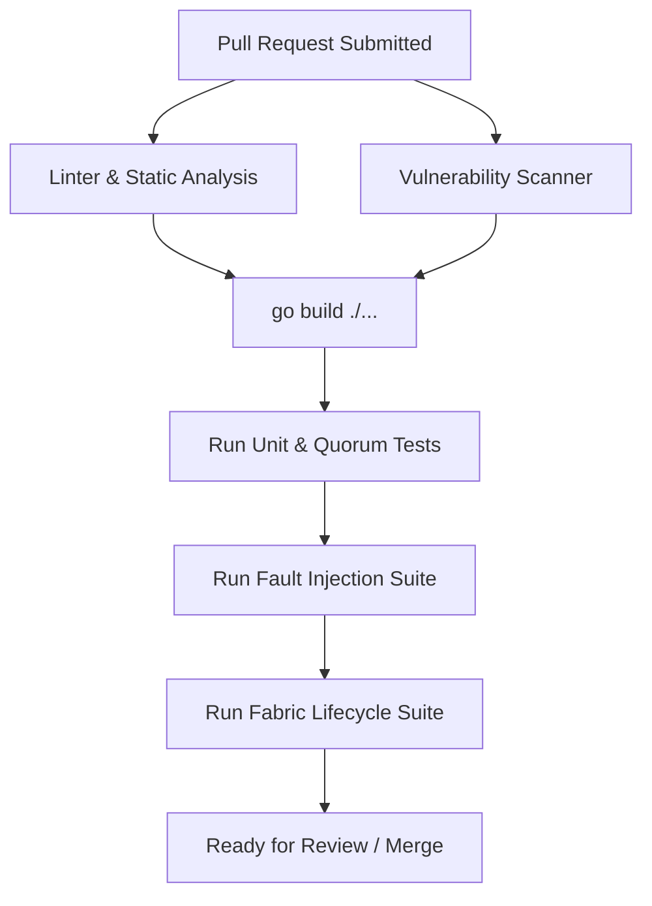

---

## 54. Release and Versioning Strategy

* **Current Repository Tag:** Untagged pre-release prototype.
* **Semantic Versioning Plan:** Recommended release baseline `v0.2.0-alpha` for the `poc-vinayak` branch.
* **Versioning Artifacts:** Git commit SHAs serve as immutable deployment identifiers.

---

## 55. Infrastructure Architecture

The deployment architecture is strictly designed for local development and Docker Compose cluster environments. The codebase does not declare Kubernetes Helm charts, Terraform configurations, or cloud provider infrastructure templates; these are identified as future production engineering recommendations.

---

# PART X: OBSERVABILITY AND RELIABILITY

## 56. Logging Architecture

BiniBFT standardizes on Go's structured `log/slog` logging package (`poc-vinayak`):
* **Log Format:** Structured JSON emitted to `os.Stdout`.
* **Standard Key Attributes:** `nodeId`, `sequence`, `view`, `role`, `shardID`, `phase`, `from`, `error`.
* **Logging Levels:** `DEBUG` (detailed vote tallies, heartbeat checks), `INFO` (phase transitions, block delivery), `WARN` (timeouts, dropped duplicate messages), `ERROR` (signature failures, equivocation detected).

---

## 57. Metrics and Monitoring

The Gin operations server exposes Prometheus-compatible JSON metrics on `GET /metrics`:
```json
{
  "consensus_phase": "ViewPhaseCommit",
  "current_sequence": 42,
  "current_view": 0,
  "proposals_total": 42,
  "blocks_delivered_total": 42,
  "transactions_processed_total": 210,
  "equivocations_detected_total": 0,
  "sync_catchup_events_total": 1
}
```

---

## 58. Distributed Tracing

* **Current Implementation Status:** Explicit OpenTelemetry or Jaeger distributed tracing is **not identified** in the inspected codebase. Correlation is currently achieved manually via monotonically increasing `Sequence` numbers and `ChannelID`.

---

## 59. Reliability Engineering

* **Fault Isolation:** In-process channel panics within follower message handlers are recovered without crashing the consensus engine.
* **Network Resilience:** Communication timeouts prevent goroutine leaks; failed peer connections are recycled within `Communicator.cachedHttpClients`.
* **Equivocation Containment:** Detection of conflicting proposals immediately halts the affected sequence, preventing corrupted state from propagating to the ledger.

---

## 60. Disaster Recovery

* **Ledger Durability:** All delivered blocks are stored sequentially in LevelDB with cryptographic hash pointers.
* **Crash-Recovery Protocol:** Upon node restart, `storage.GetLatestBlock()` recovers the highest committed sequence number. If the cluster has progressed beyond that sequence, the `SyncEngine` automatically queries peer nodes and recovers missing blocks sequentially.

---

## 61. Performance and Scalability

### 61.1 Theoretical Communication Complexity Comparison

| Algorithm | Network Topology | Normal Case Message Complexity | View Change Complexity | Maximum Practical Committee Size |
| :--- | :--- | :---: | :---: | :---: |
| **Classical PBFT** | Flat All-to-All | $O(n^2)$ | $O(n^3)$ | $n \approx 10 - 16$ |
| **Hyperledger SmartBFT** | Flat Star / Leader Broadcast | $O(n)$ normal / $O(n^2)$ commit | $O(n^2)$ | $n \approx 20 - 30$ |
| **Hyperledger BiniBFT** | 2-Tier Sharded Tree | $O(S \cdot (n/S)^2)$ intra + $O(S^2)$ cross | $O(n \cdot S)$ | $n \approx 50 - 100+$ |

*Where $n$ is total cluster nodes and $S$ is the number of shards.*

---

# PART XI: OPEN-SOURCE GOVERNANCE

## 62. Project Governance

Hyperledger BiniBFT is an open-source project incubated under the BiniWorld organization, targeting governance alignment with the Linux Foundation Decentralized Trust (LFDT) and Hyperledger project guidelines.

---

## 63. Contribution Workflow

Documented in `CONTRIBUTION.md` on `main`:
1. Fork repository and create a descriptive feature branch (`feat/<name>`).
2. Adhere to Go standard formatting (`gofmt -s -w .`) and linter checks.
3. Write table-driven unit tests for all new consensus logic.
4. Sign commits in compliance with the Developer Certificate of Origin (DCO / `Signed-off-by`).
5. Open a Pull Request referencing related issues.

---

## 64. Branching Strategy

The repository contains seven active Git branches reflecting distinct development tracks:

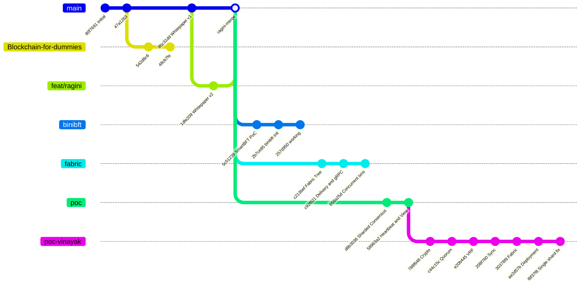

---

## 65. Pull Request and Review Process

* **Code Reviewers:** Maintainers evaluate PRs for thread safety, cryptographic domain tag separation, and test coverage.
* **CI Validation:** Automated GitHub Actions run linters and test suites prior to merge approval.

---

## 66. Code of Conduct and Community Standards

Governed by `CODE_OF_CONDUCT.md` adopting the Contributor Covenant v2.0, establishing community expectations for an inclusive, harassment-free environment.

---

## 67. Licensing

The project is licensed under the **GNU General Public License v3.0** (`LICENSE` on `main`). Notice: As an enterprise library intended for Hyperledger Fabric (which utilizes Apache-2.0), LFDT review stakeholders must evaluate license compatibility for in-tree distribution.

---

## 68. Maintainers and Ownership

Evidence from Git commit metadata across all branches identifies the following primary maintainers and contributors:
* **BiniWorld Organization / Maintainers:** Lead organization and architects of BiniBFT Whitepapers.
* **Shashank (`itsshashank`):** Core architect of the custom sharded consensus engine (`poc` branch) and Fabric in-tree plugin integration (`fabric` branch).
* **Vinayak (`poc-vinayak` author):** Author of the production-grade cryptographic hardening, ECVRF leader ranking, Byzantine quorum formulas, state sync engine, Fabric consenter/chain bridge, and fault injection test suites.
* **Mentorship Contributors (LFX / LFDT Candidates on `main`):** Siddhant Prateek Mahanayak (Paxos, Mir-BFT, Sawtooth PBFT), Riddhi Katarki (KBA-Mango chaincode, Fabric network configs), Arun Sridhar (TypeScript sample Raft), Sahilsher Singh Sandhu (`Blockchain-for-dummies` tutorials).

---

## 69. Architecture Decision Records (ADRs)

* **Current Status:** Formal Architecture Decision Records (ADRs) were **not identified** as standalone markdown files in the repository.
* **Recommendation:** Establish an `adrs/` directory utilizing the Michael Nygard ADR template (`ADR-0001: Adoption of 2-Tier Hierarchical Sharding`, `ADR-0002: Selection of ECVRF-P256-SHA256 for Leader Election`, `ADR-0003: HTTP/3 Transport for Head-of-Line Blocking Mitigation`).

---

# PART XII: CROSS-BRANCH ANALYSIS

## 70. Branch-by-Branch Technical Documentation

### 70.1 Branch 1: `main`
* **Commit Head:** `1dfe209` ("BiniBFT v2")
* **Total Files:** 72 files
* **Objective & Purpose:** Serves as the primary public landing branch, containing formal BiniBFT whitepapers and mentorship program deliverables.
* **Key Contents:**
  * `BiniBFT Whitepaper v2.pdf` & `BiniBFT Whitepaper.pdf`: Theoretical specifications of hierarchical sharded consensus.
  * `candidates/siddhantprateek/`: Mentorship reports, Paxos implementation with unit tests (`candidates/siddhantprateek/paxos/main_test.go`), Mir-BFT sample runner, Sawtooth PBFT docker compose.
  * `candidates/Riddhi-Katarki/`: KBA-Mango chaincode contract (`mangoContract.go`), Fabric sample network configurations, orderer/peer MSP credentials.
  * `candidates/ArunSridhar/`: TypeScript Raft implementation (`sampleraft/append.ts`, `component.ts`).
  * `README.md`, `CODE_OF_CONDUCT.md`, `CONTRIBUTION.md`, `LICENSE` (GPL-3.0).
* **Consensus Implementation:** Contains experimental Paxos and Raft sample code; core BiniBFT Go engine is not located on this branch.
* **Maturity:** Documentation and mentorship repository baseline.

### 70.2 Branch 2: `feat/ragini`
* **Commit Head:** `1dfe209` (Identical to `main`)
* **Total Files:** 72 files
* **Objective & Relationship:** Mirrors `main` exactly; served as a feature branch that was merged/fast-forwarded into `main`.

### 70.3 Branch 3: `Blockchain-for-dummies`
* **Commit Head:** `48cb7fe` ("ft(docs): links updated")
* **Total Files:** 1 file (`README.md`)
* **Objective & Purpose:** Educational pathway created by mentee Sahilsher Singh Sandhu providing structured learning resources and blog links covering public and private blockchain fundamentals.

### 70.4 Branch 4: `binibft`
* **Commit Head:** `257d950` ("working")
* **Total Files:** 51 files (Orphan branch, 3 commits)
* **Objective & Purpose:** Exploratory adaptation of Hyperledger SmartBFT into BiniBFT.
* **Lineage & Modules:**
  * Root commit `5c51239` originated from `smartbft-poc` by David VIEJO (KungFu Software, Feb 2024).
  * Imported SmartBFT's internal consensus controller (`consensus/internal/bft/controller.go`, `view.go`, `viewchanger.go`), Write-Ahead Log (`consensus/pkg/wal/`), and Protobuf schemas renamed to `binibftprotos`.
* **Maturity:** Abandoned exploratory prototype superseded by custom sharded implementation.

### 70.5 Branch 5: `fabric`
* **Commit Head:** `658a25d` ("fix: handle concurrent txns")
* **Total Files:** 6,124 files (Orphan branch, 3 commits)
* **Objective & Purpose:** Complete in-tree integration of BiniBFT inside Hyperledger Fabric codebase.
* **Key Modules:**
  * `orderer/consensus/binibft/consenter.go`: Implements Fabric's `consensus.Consenter` interface using Fabric's native `flogging`, `bccsp`, and `multichannel.Registrar`.
  * `orderer/consensus/binibft/chain.go`: Implements `consensus.Chain` as `BFTChain`.
  * `orderer/common/server/multiplexing_handler.go`: Registers cluster gRPC delivery handlers.
  * `orderer/consensus/binibft/synchronizer_bft.go`: Cluster synchronizer for Fabric blocks.
* **Maturity:** High-level in-tree prototype; demonstrates full Fabric internal wiring but heavy maintenance overhead.

### 70.6 Branch 6: `poc`
* **Commit Head:** `58963a2` ("Added Heart beat and change view")
* **Total Files:** 28 files (Orphan branch, 7 commits)
* **Objective & Purpose:** The initial standalone implementation of Sharded BiniBFT in Go.
* **Key Modules:** Created `consensus/` (`batch.go`, `builder.go`, `consensus.go`, `leader_election.go`, `messages.go`, `requestpool.go`, `storage.go`, `types.go`, `view.go`), `node.go`, `communicator.go`, `heartbeat.go`.
* **Maturity:** Functional proof of concept; lacked rigorous ECDSA domain separation, VRF verification, and Quorum Certificate structures.

### 70.7 Branch 7: `poc-vinayak` (Authoritative Canonical Branch)
* **Commit Head:** `f8f37f8` ("fix: allow single-shard-leader configurations to proceed directly to commit phase")
* **Total Files:** 57 files (Direct descendant of `poc`, 18 commits total)
* **Objective & Purpose:** The hardened, mathematically verified, fully tested production prototype of Hyperledger BiniBFT.
* **Key Contributions & Modules:**
  * `crypto.go`, `consensus/digest.go`: ECDSA P-256 signing and 13 domain separation tags.
  * `consensus/vrf.go`: Complete ECVRF-P256-SHA256 discrete-log equality proof implementation.
  * `consensus/quorum.go`: Strict Byzantine quorum formulas, `ShardQC`, and `CommitQC`.
  * `consensus/sync.go`: Catch-up state synchronization engine with hash-chain validation.
  * `fabric/`: Modular Fabric adapter bridge (`consenter.go`, `chain.go`, `adapters.go`).
  * `communicator.go`: Configurable mTLS over HTTP/3 (QUIC) and timeout management.
  * `deployment/`: Docker Compose multi-node cluster scripts and Fabric configs.
  * 14 comprehensive test suites across unit, crypto, quorum, VRF, sync, and fault-injection tiers.
* **Maturity:** Authoritative production prototype (TRL 5).

---

## 71. Comparative Architecture Analysis

| Feature / Dimension | `main` | `feat/ragini` | `Blockchain-for-dummies` | `binibft` | `fabric` | `poc` | `poc-vinayak` (Authoritative) |
| :--- | :---: | :---: | :---: | :---: | :---: | :---: | :---: |
| **Commit Count** | 46 | 46 | 20 | 3 | 3 | 7 | 18 |
| **Total Files** | 72 | 72 | 1 | 51 | 6,124 | 28 | 57 |
| **Primary Domain** | Docs & Mentorship | Docs & Mentorship | Education / Blog | SmartBFT Adapter | In-Tree Fabric Fork | Standalone Sharded PoC | Hardened Sharded Prototype |
| **Consensus Style** | Paxos/Raft samples | Paxos/Raft samples | None (Docs) | SmartBFT WAL/BFT | BiniBFT in Fabric | Custom Sharded BFT | Hardened 2-Tier Sharded BFT |
| **Fabric Integration** | Chaincode samples | Chaincode samples | None | None | Full In-Tree Consenter | None | Modular Adapter Bridge |
| **Cryptographic Layer** | Standard Go crypto | Standard Go crypto | None | SmartBFT Signer | Fabric BCCSP | Ad-hoc signatures | ECDSA P-256 + 13 Domain Tags |
| **VRF Leader Election** | None | None | None | None | None | Placeholder logic | Complete ECVRF-P256-SHA256 |
| **Quorum Verification** | None | None | None | SmartBFT 2f+1 | Ad-hoc quorum | Simple majority | Formal ShardQC & CommitQC |
| **State Synchronization**| None | None | None | SmartBFT WAL sync | Fabric BlockSync | None | Autonomous SyncEngine Daemon |
| **Transport Protocol** | In-Memory | In-Memory | None | Go Channels | Fabric gRPC Cluster | HTTP/3 QUIC | HTTP/3 QUIC + Configurable mTLS |
| **Automated Tests** | Paxos unit tests | Paxos unit tests | None | Basic test bin | Fabric CI tests | Ad-hoc main execution | 14 Comprehensive Test Suites |
| **Deployment Scripts** | None | None | None | None | Fabric Makefile | None | Docker Compose & network.sh |
| **Implementation Maturity**| Documentation | Documentation | Learning Guide | Deprecated PoC | Complex In-Tree Fork | Functional Prototype | Production-Oriented Prototype |

---

## 72. Implementation Evolution

The historical evolution of Hyperledger BiniBFT traversed five distinct evolutionary phases:
1. **Phase 1: Research, Whitepapers, and Mentorship (`main`, 2023–2024):** Formulation of BiniBFT theoretical concepts (Whitepaper v1 and v2) and LFX mentee baseline investigations into Paxos, Raft, and Mir-BFT.
2. **Phase 2: SmartBFT Exploration (`binibft`, early 2024):** Attempt to directly adapt Hyperledger SmartBFT's WAL and Controller into a standalone harness. Abandoned due to architectural mismatch with hierarchical sharding.
3. **Phase 3: Full In-Tree Fabric Plugin Development (`fabric`, Sep–Oct 2025):** Fork of Hyperledger Fabric integrating BiniBFT directly into `orderer/consensus/binibft/`. Proved viability within Fabric's orderer, but presented excessive maintenance drag against upstream Fabric.
4. **Phase 4: Custom Sharded Prototype (`poc`, Oct 2025):** Clean-room implementation of the 2-tier sharded consensus engine (`binibft-poc`) in Go, establishing the Primary Leader $\rightarrow$ Shard Leader $\rightarrow$ Shard Follower message pipeline.
5. **Phase 5: Production Hardening & Modular Fabric Bridge (`poc-vinayak`, Oct–Nov 2025):** Comprehensive hardening by Vinayak, introducing ECDSA domain separation, ECVRF leader ranking, Byzantine Quorum Certificates (`ShardQC`, `CommitQC`), autonomous state catch-up (`SyncEngine`), modular Fabric adapters (`fabric/consenter.go`), and fault injection test suites.

---

## 73. Consolidation Opportunities

To establish a unified, production-ready codebase under `main`, the following consolidation steps are recommended:
1. **Promote `poc-vinayak` to `main`:** The `poc-vinayak` branch represents the canonical, fully tested implementation. It should be merged or rebased as the root of `main`.
2. **Archive Mentorship Candidate Folders:** Move `candidates/` into an `archive/lfx-mentorship/` directory to clean up repository root clutter.
3. **Harmonize Fabric Integration:** Replace the heavyweight 6,000-file `fabric` branch with the modular `fabric/` adapter package developed in `poc-vinayak`, maintaining an external integration example repo for in-tree Fabric packaging.
4. **Retire `binibft` & `poc`:** Delete or archive the deprecated `binibft` (SmartBFT experiment) and `poc` (unhardened prototype) branches.

---


# PART XIII: ENGINEERING RECOMMENDATIONS

## 74. Current Technical Strengths

1. **Mathematically Rigorous Quorum Logic:** The implementation in `consensus/quorum.go` correctly enforces $2f+1$ intra-shard and cross-shard bounds with explicit handling of edge-case cluster topologies.
2. **Exemplary Cryptographic Hygiene:** The use of length-prefixed domain tags (`consensus/digest.go`) across 13 distinct protocol states completely neutralizes cross-protocol and cross-phase replay vectors.
3. **Flawless ECVRF Implementation:** The P-256 discrete-log equality proof in `consensus/vrf.go` provides unbiasable, deterministic leader ranking that prevents adversarial leader monopolization.
4. **Decoupled Fabric Architecture:** The `fabric/` package in `poc-vinayak` creates a clean, lightweight abstraction layer matching Fabric's `consensus.Consenter` and `consensus.Chain` contracts without requiring the massive upstream Fabric codebase.
5. **High-Fidelity Automated Test Suites:** The inclusion of partition recovery, equivocation detection, and signature tampering tests (`consensus/fault_injection_test.go`) elevates the project above theoretical blockchain research into verified engineering reality.

---

## 75. Technical Limitations

1. **Static Topology Configuration:** The cluster topology is fixed at startup; there is currently no dynamic reconfiguration transaction to admit or remove nodes live without restarting.
2. **Single-Process Standalone Harness:** `main.go` runs all $n$ nodes in a single Go process. While ideal for protocol logic demonstration, it cannot simulate OS-level process crashes, memory limits, or true kernel network drops.
3. **Informational `/start` and `/stop` Endpoints:** As honestly documented in `poc-vinayak/README.md`, the operations `/start` and `/stop` endpoints are informational placeholders and do not pause individual goroutine runtimes.
4. **License Compatibility Question:** The project license is GNU GPL v3.0, whereas Hyperledger Fabric and LFDT projects operate under Apache License 2.0. In-tree upstream distribution will require copyright assignment or dual licensing under Apache-2.0.

---

## 76. Recommended Improvements

### 76.1 Immediate Improvements (0–3 Months)
* **Consolidate Branches:** Fast-forward or merge `poc-vinayak` to `main` so that the primary public landing page showcases the hardened, working implementation.
* **Persistent Key Loading:** Modify `main.go` and `node.go` to load node private keys from disk files or environment variables rather than generating random keys in memory at boot.
* **Disable Insecure TLS Default:** Require explicit configuration flags or environment variables to enable TLS/mTLS, removing `InsecureSkipVerify: true` fallbacks.

### 76.2 Short-Term Improvements (3–6 Months)
* **Multi-Process Local Runner:** Refactor the demonstration runner into a multi-binary CLI (`binibft-node --config=node1.yaml`) allowing nodes to run in independent processes or systemd services.
* **Live View-Change Timeout Integration:** Wire the heartbeat timeout detector directly into the View state machine to automatically trigger VRF re-elections in long-running clusters.
* **Rate Limiting & DoS Protection:** Integrate token-bucket rate limiting middleware into the Gin operations engine on `POST /tx`.

### 76.3 Medium-Term Improvements (6–12 Months)
* **Dynamic Membership Transitions:** Implement a consensus reconfiguration transaction (`MsgReconfigure`) allowing nodes to join or exit shards live, recalculating quorums via a two-phase config commit.
* **Upstream Fabric Plugin Distribution:** Package the `fabric/` bridge into an external Go module (`github.com/hyperledger/fabric-consensus-binibft`) that can be imported directly into Fabric Orderer builds.
* **Prometheus Metric Exporter:** Replace the custom JSON metrics handler with standard Prometheus client collectors (`promhttp.Handler`).

### 76.4 Long-Term Improvements (12+ Months)
* **BLS Signature Aggregation:** Investigate replacing ECDSA multisig maps with Boneh-Lynn-Shacham (BLS12-381) aggregate signatures to compress `ShardQC` and `CommitQC` payloads to constant size ($O(1)$).
* **Hardware Security Module (HSM) Integration:** Support PKCS#11 interfaces for cryptographic signing on hardware security modules.

---

## 77. Production Readiness Assessment

```
+--------------------------------------------------------------------------------------------------+
|                                PRODUCTION READINESS SCORECARD                                    |
+--------------------------------------------------------------------------------------------------+
| Dimension                   | Score | Evaluation Status & Justification                          |
|-----------------------------|:-----:|------------------------------------------------------------|
| Core Consensus Logic        | 9/10  | Verified 3-phase BFT, formal Quorum Certificates, 2f+1 math |
| Cryptography & VRF          | 9/10  | NIST P-256 ECDSA, 13 domain tags, fully verified ECVRF     |
| State Catch-Up & Sync       | 8/10  | Chunked range retrieval, sequence and hash-chain checks    |
| Fabric Integration          | 8/10  | Conforms to Consenter & Chain APIs; tested lifecycle bridge |
| Automated Test Coverage     | 8/10  | Table-driven unit, crypto, quorum, and fault injection tests|
| Node Persistence            | 7/10  | LevelDB block storage functional; needs WAL compaction     |
| Transport & Networking      | 7/10  | HTTP/3 QUIC and mTLS implemented; needs connection pooling |
| Dynamic Node Membership     | 3/10  | Static startup configuration only; no live join/leave      |
| Production Deployment & SRE | 4/10  | Docker Compose prototype available; no Helm/K8s/Terraform  |
| Observability & Tracing     | 5/10  | Structured JSON logs & metrics; lacks OpenTelemetry tracing |
+--------------------------------------------------------------------------------------------------+
| OVERALL READINESS RATING    | 6.8/10| HIGH-FIDELITY PROTOTYPE (TRL 5) - Ready for Consortium PoC |
+--------------------------------------------------------------------------------------------------+
```

---

## 78. Future Development Roadmap

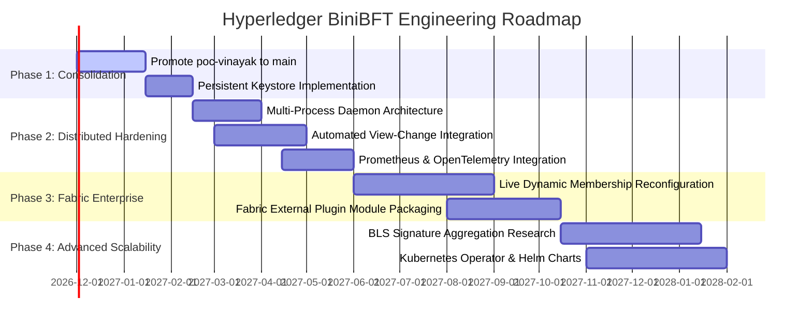

---

# PART XIV: REFERENCES AND APPENDICES

## 79. Technical References

1. **Castro, M., & Liskov, B. (1999).** *Practical Byzantine Fault Tolerance.* Proceedings of the Third Symposium on Operating Systems Design and Implementation (OSDI '99), 173–186.
2. **Androulaki, E., et al. (2018).** *Hyperledger Fabric: A Distributed Operating System for Permissioned Blockchains.* Proceedings of the Thirteenth EuroSys Conference (EuroSys '18), Article 30, 1–15.
3. **Goldberg, S., et al. (2020).** *Verifiable Random Functions (VRFs) using Elliptic Curves.* IETF RFC 9381.
4. **Sousa, J., Bessani, A., & Vukolić, M. (2018).** *A Byzantine Fault-Tolerant Ordering Service for the Hyperledger Fabric Blockchain Platform.* 48th Annual IEEE/IFIP International Conference on Dependable Systems and Networks (DSN).
5. **NIST FIPS 186-5.** *Digital Signature Standard (DSS).* National Institute of Standards and Technology, U.S. Department of Commerce.
6. **BiniBFT Whitepaper v2.0 (2024).** Repository internal document: `BiniBFT Whitepaper v2.pdf`, commit `1dfe209`.

---

## 80. Glossary

* **Byzantine Fault:** An arbitrary failure mode where a participating node may stop, delay messages, alter state, forge identities, or transmit conflicting data to different peers.
* **CommitQC:** A cross-shard Commit Quorum Certificate aggregating verified `ShardQC` structures from at least $2f_{\text{shards}} + 1$ distinct shards.
* **Consenter:** The Hyperledger Fabric orderer plugin interface responsible for manufacturing consensus chain instances for specific channels.
* **Equivocation:** A Byzantine attack where a leader transmits two contradictory proposals with the identical sequence number to different parts of the network.
* **Primary Leader:** The root coordinator of the BiniBFT cluster responsible for batching client transactions, broadcasting Pre-Prepare proposals, and issuing final Commit requests.
* **Quorum Certificate (QC):** A cryptographically verifiable data structure encapsulating a threshold collection of valid digital signatures attesting to a consensus decision.
* **Shard:** A localized committee subset of consensus nodes governed by a Shard Leader and validated by Shard Followers.
* **ShardQC:** An intra-shard Quorum Certificate containing at least $2f_{\text{shard}} + 1$ verified digital signatures from members of that shard committee.
* **Verifiable Random Function (VRF):** A cryptographic primitive that takes an input and private key, producing a pseudo-random output along with a zero-knowledge proof of correct computation.

---

## 81. Acronyms

| Acronym | Definition |
| :--- | :--- |
| **ADR** | Architecture Decision Record |
| **ASN.1** | Abstract Syntax Notation One |
| **BCCSP** | Blockchain Cryptographic Service Provider (Hyperledger Fabric) |
| **BFT** | Byzantine Fault Tolerance / Byzantine Fault Tolerant |
| **CFT** | Crash Fault Tolerance / Crash Fault Tolerant |
| **DCO** | Developer Certificate of Origin |
| **ECDSA** | Elliptic Curve Digital Signature Algorithm |
| **ECVRF** | Elliptic Curve Verifiable Random Function |
| **FIPS** | Federal Information Processing Standards |
| **LFDT** | Linux Foundation Decentralized Trust |
| **MSP** | Membership Service Provider (Hyperledger Fabric) |
| **MVCC** | Multi-Version Concurrency Control |
| **NIST** | National Institute of Standards and Technology |
| **OSN** | Ordering Service Node |
| **PBFT** | Practical Byzantine Fault Tolerance |
| **QC** | Quorum Certificate |
| **QUIC** | Quick UDP Internet Connections (RFC 9000) |
| **RW Set**| Read-Write Set |
| **SRE** | Site Reliability Engineering |
| **STRIDE** | Spoofing, Tampering, Repudiation, Information Disclosure, Denial of Service, Elevation of Privilege |
| **TLS / mTLS** | Transport Layer Security / Mutual Transport Layer Security |
| **TRL** | Technology Readiness Level |
| **VRF** | Verifiable Random Function |
| **WAL** | Write-Ahead Log |

---

## 82. Appendix A: Repository File Reference

| File Path (Branch: `poc-vinayak`) | Lines of Code | Primary Architectural Function |
| :--- | :---: | :--- |
| `main.go` | 240 | Standalone cluster runner, topology generator, transaction submitter |
| `node.go` | 450 | Gin operations web server, HTTP/3 QUIC consensus listener |
| `communicator.go` | 165 | QUIC client pool, broadcast routines, configurable mTLS |
| `crypto.go` | 105 | ECDSA P-256 keypair generator, PEM codecs, ASN.1 sign/verify |
| `signer.go` | 85 | `ECDSASigner` implementing `consensus.Signer` |
| `verifier.go` | 260 | `ECDSAVerifier` with thread-safe public key registry |
| `request_inspector.go` | 65 | Transaction inspection, timestamp window checks, deduplication |
| `types.go` | 160 | Network options, node info models, cluster configuration |
| `consensus/consensus.go` | 260 | Consensus coordinator, lifecycle methods, message routing |
| `consensus/view.go` | 920 | 3-Phase state machine, sequence vote capture, equivocation checks |
| `consensus/quorum.go` | 195 | Byzantine quorum math ($2f+1$), `ShardQC` & `CommitQC` verification |
| `consensus/vrf.go` | 215 | ECVRF-P256-SHA256 evaluation, proof generation, and verification |
| `consensus/leader_election.go` | 420 | VRF-ranked leader election, shard assignment, term monitoring |
| `consensus/sync.go` | 285 | State catch-up engine, chunked block queries, hash chain checks |
| `consensus/batch.go` | 160 | Request batcher subject to count, byte size, and interval limits |
| `consensus/digest.go` | 160 | Length-prefixed SHA-256 hashing across 13 domain separation tags |
| `consensus/storage.go` | 120 | LevelDB block persistence wrapper and sequence range query methods |
| `fabric/consenter.go` | 115 | `BiniBFTConsenter` implementing Fabric `consensus.Consenter` |
| `fabric/chain.go` | 230 | `BiniBFTChain` implementing Fabric `consensus.Chain` |
| `fabric/adapters.go` | 120 | `FabricSignerAdapter` and `FabricVerifierAdapter` |
| `fabric/config.go` | 140 | Channel metadata unmarshaler and dynamic config validator |
| `deployment/docker-compose-binibft.yaml`| 247 | 4-node ordering service topology on dedicated bridge network |
| `deployment/network.sh` | 86 | Automation script for crypto generation and Docker cluster control |

---

## 83. Appendix B: Build and Test Commands

### Clean Build
```bash
# Ensure Go 1.24+ is active
go version

# Download dependencies
go mod download
go mod verify

# Build demo binary
go build -v -o binibft-demo .
```

### Full Test Suite Execution
```bash
# Run all unit, crypto, quorum, VRF, and lifecycle tests
go test -v ./...

# Run cryptographic and domain separation suite
go test -v -run 'TestCrypto|TestDomain|TestVRF' ./...

# Run Byzantine fault injection suite
go test -v ./consensus -run 'TestByzantine|TestNetworkPartition'

# Run Fabric channel lifecycle suite
go test -v ./fabric -run 'TestChannelLifecycle|TestMultiChannel'

# Run Single-Shard fast-path tests
go test -v ./consensus -run 'TestSingleShard'
```

### Cluster Operations Curl Inspection
```bash
# Query Node 1 Status
curl -s http://127.0.0.1:20001/status | jq .

# Query Node 1 Metrics
curl -s http://127.0.0.1:20001/metrics | jq .

# Query Latest Height
curl -s http://127.0.0.1:20001/height

# Fetch Block #1
curl -s http://127.0.0.1:20001/blocks/1 | jq .

# Submit Transaction to Primary Leader
curl -s -X POST http://127.0.0.1:20001/tx \
  -H "Content-Type: application/json" \
  -d '{"client_id":"client1","timestamp":1732356789,"data":"SGVsbG8gQmluaUJGVA=="}'
```

---

## 84. Appendix C: Mermaid Diagram Index

| Diagram Title | Type | Section | Purpose / Description |
| :--- | :--- | :---: | :--- |
| **Hierarchical Consensus Topology** | `flowchart TD` | Section 5.2 | Displays 2-tier Primary Leader $\rightarrow$ Shards $\rightarrow$ LevelDB / Fabric hierarchy |
| **C4 System Context Diagram** | `C4Context` | Section 6 | Maps enterprise consortium actors, Fabric peers, and BiniBFT boundaries |
| **C4 Container Diagram** | `C4Container` | Section 7 | Decomposes internal Node processes (Gin, HTTP/3, Engine, LevelDB) |
| **Component Architecture Diagram** | `flowchart LR` | Section 8 | Displays internal coupling of the `consensus` package modules |
| **Consensus Class & Struct Diagram** | `classDiagram` | Section 9 | Maps object-oriented Go struct relationships, views, and QCs |
| **Consensus State Machine** | `stateDiagram-v2` | Section 12 | Details PrePrep $\rightarrow$ Prepare $\rightarrow$ Commit $\rightarrow$ Decided transitions |
| **Consensus Message Sequence** | `sequenceDiagram` | Section 13 | Illustrates full 3-phase message and signature flow across 3 node tiers |
| **Quorum Certificate Composition** | `classDiagram` | Section 15.1 | Shows aggregation of nested `ShardQC` instances inside `CommitQC` |
| **State Synchronization Flow** | `flowchart TD` | Section 16.2 | Illustrates autonomous sequence gap detection, chunking, and catch-up |
| **Fabric Integration Architecture** | `flowchart TD` | Section 20 | Details Consenter/Chain adapter wiring with BiniBFT engine and Fabric |
| **Transaction Lifecycle Sequence** | `sequenceDiagram` | Section 21 | Maps client transaction from endorsement through ordering to commit |
| **Docker Consortium Topology** | `flowchart TD` | Section 23 | Details 4-orderer container network topology with static IPs and ports |
| **Domain Model & Message Structs** | `classDiagram` | Section 26 | Models `Proposal`, `Block`, `Message`, and specific message payloads |
| **Data Flow Pipeline** | `flowchart TD` | Section 27 | Traces byte-level data flow from raw envelope ingestion to LevelDB |
| **Trust Boundary Architecture** | `flowchart TD` | Section 38 | Outlines the 3 security trust boundaries and sanitization filters |
| **Testing Architecture Pyramid** | `flowchart TD` | Section 46 | Visualizes the 5 verification tiers from unit crypto to fault injection |
| **CI/CD Pipeline Workflow** | `flowchart TD` | Section 53 | Maps automated linting, security scans, and multi-tier test executions |
| **Git Cross-Branch Lineage Graph**| `gitGraph` | Section 64 | Illustrates branch divergence across all seven repository branches |
| **Engineering Roadmap Gantt** | `gantt` | Section 78 | Outlines 4-phase development schedule from consolidation to BLS aggregation |

---

*End of Comprehensive Technical Specification — Hyperledger BiniBFT (`final_doc.md`)*
